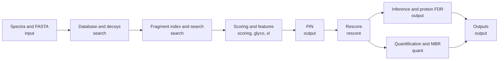

# Architecture

How andes is put together: the pipeline, the crates, the types that carry data between stages and
where to add things. For the command-line reference see [`DOCS.md`](DOCS.md); for the rules a
change must follow see [`CONTRIBUTING.md`](CONTRIBUTING.md) and [`AGENTS.md`](AGENTS.md).

## 1. What andes is

andes is a peptide identification and quantification engine for tandem mass spectra: database
search, rescoring, protein inference with protein-level FDR, and label-free, isobaric and SILAC
quantification. It is one Cargo workspace of twelve crates under `crates/` that builds one
binary, `andes` (`crates/andes/src/bin/andes/main.rs`). The crates are libraries with one pipeline
role each; the binary wires them together, owns the command line and is the only place that prints.
There is no plug-in boundary: a change that spans stages is one change in one repository.

## 2. Pipeline map

Each stage and where it lives:

| Stage | Crate | Entry points |
|---|---|---|
| Read spectra and database | `crates/input` | `mzml.rs`, `mgf.rs`, `thermo.rs`, `timstof.rs`, `database.rs` |
| Digestion, decoys | `crates/search` | `candidates.rs`, `decoy.rs` |
| Index and match | `crates/search` | `fragments/index.rs`, `precursor/matching.rs`, `engine.rs` |
| Features and learned scores | `crates/scoring` | `features/fragment.rs`, `gbdt.rs`, `rt.rs` |
| PIN | `crates/output` | `pin.rs` |
| Rescoring | `crates/rescore` | `run.rs`, `svm.rs`, `pep.rs` |
| Protein inference | `crates/output` | `protein_inference.rs` |
| Quantification | `crates/quant` | `xic.rs`, `lfq.rs`, `isobaric.rs`, `library.rs` |
| Tables and views | `crates/output` | `qpx.rs`, `pg_parquet.rs`, `quant_out.rs` |

## 3. Crates

| Crate | What it owns | What it must not do |
|---|---|---|
| `crates/model` | Shared domain types: amino acids, modifications, peptides, proteins, spectra, tolerances, instruments, enzymes, FDR helpers. | Depend on another workspace crate or hold a pipeline stage. |
| `crates/input` | Reading spectra (mzML, MGF, Thermo raw, timsTOF), protein databases (FASTA, UniProt, PEFF) and acquisition metadata. | Score, search or write result files. |
| `crates/search` | Candidate peptides, the fragment index, precursor matching, open and chimeric search, decoys, PSM scoring and refinement. | Read files other than through `input`, or write outputs. |
| `crates/scoring` | Fragment, ion and peak features, the retention-time model, the gradient-boosted tree evaluator. | Train models or perform FDR control. |
| `crates/onnx-infer` | ONNX inference for the fragment-intensity and retention-time predictors. | Know about PSMs or the pipeline. |
| `crates/glyco` | Glycan compositions and masses, oxonium evidence, sequons and glycan-first matching. | Run its own FDR; it supplies candidates and features. |
| `crates/xl` | Cross-linkers, peptide-pair candidates, doublets, cross-link decoys, error control and site roll-up. | Replace the linear search; it extends it. |
| `crates/rescore` | The Percolator algorithm run in process, writing Percolator's result files. | Read spectra or know the search internals; its input is a PIN. |
| `crates/quant` | Chromatogram extraction, alignment, label-free and isobaric intensities, match-between-runs, normalisation. | Change an identification or its q-value. |
| `crates/output` | PIN, Parquet and QPX writers, atomic writes, protein inference, provenance. | Compute scores; it serialises results other crates produce. |
| `crates/model-train` | Offline training of the learned models and their stores. | Run during a search. |
| `crates/andes` | The binary: command line, configuration, SDRF and cohort handling, orchestration of the stages. | Hold algorithms that another crate could own. |

Library crates never print: they return values or errors, and the binary reports through the
`log` crate (`crates/andes/src/bin/andes/logging.rs`, rules in
[`docs/dev/clean-logs.md`](docs/dev/clean-logs.md)). A structure test enforces it: no print
macros outside `logging.rs` and the files on the allowlist in `structure.rs` (`PRINT_ALLOWED`),
library crates and binary alike.

## 4. DDA data flow

1. **Read.** `input` yields `model::Spectrum` values (`crates/model/src/spectrum.rs`), with MS1
   scans linked through `Ms1Link` (`crates/input/src/mzml.rs`), and a `model::ProteinDb`
   (`crates/model/src/protein.rs`) from `load_protein_database` (`crates/input/src/database.rs`).
2. **Database.** `search::decoy::build_search_db` adds decoys under a `DecoyStrategy`
   (`crates/search/src/decoy.rs`). `SearchIndex` (`crates/search/src/index.rs`) holds the
   peptides; `ChunkFragmentIndex` (`crates/search/src/fragments/index.rs`) is the fragment index, built
   in mass-ordered chunks so memory stays bounded.
3. **Search.** `SearchParams` (`crates/search/src/params.rs`) carries every setting.
   `engine.rs` retrieves candidates per spectrum and scores them into `PsmMatch` values
   (`crates/search/src/psm.rs`), each holding its `PsmFeatures`. `TopNQueue` keeps the best few
   per spectrum. `refinement.rs` runs a second pass restricted to confident proteins.
4. **Features.** `scoring` adds fragment, retention-time and tree-model features to each PSM;
   `glyco` and `xl` supply their candidate types for glyco and cross-link runs.
5. **PIN.** `output::write_pin` (`crates/output/src/pin.rs`) writes one row per PSM with the
   features as columns; `psm_feature_values` is the single place the column set is defined.
6. **Rescore.** `rescore::run` (`crates/rescore/src/run.rs`) trains the semi-supervised model
   with cross-validation and writes scores, q-values and PEPs as Percolator result files. `output::percolator` reads the
   results back into `PercolatorPsm` (`crates/output/src/percolator.rs`).
7. **Inference.** `output::infer_protein_groups` (`crates/output/src/protein/inference.rs`)
   builds `ProteinGroup` values with protein-level q-values.
8. **Quantification.** `quant` extracts chromatograms (`xic.rs`), aligns runs (`align.rs`),
   builds the match-between-runs `Library` (`library.rs`), quantifies precursors (`lfq.rs`,
   `isobaric.rs`) and normalises (`normalize.rs`). The staged form is the `andes quant`
   subcommand (`crates/andes/src/bin/andes/quant.rs`, `quant_finalize.rs`).
9. **Write.** `output::write_qpx` and `write_pg_parquet` write the views; the quantification
   tables come from `quant_out.rs`.

The binary's subcommands live in `crates/andes/src/bin/andes/`: the default search
(`search.rs`), `quant` (`quant_cmd.rs`), `cohort` (`cohort_cmd.rs`), `inference`
(`inference_cmd.rs`), `rescore`, and the training commands (`train.rs`, `train_intensity.rs`).
DIA has its own modules there (`dia.rs`, `dia_score.rs`, `dia_xrun.rs` and related); cross-linking
runs through `xl_run.rs`, `xl_fdr.rs`; glyco through `glyco_run.rs`.

## 5. Where do I add

- **An input format.** A reader in `crates/input/src/` that returns `model::Spectrum`; export it
  from `crates/input/src/lib.rs`, dispatch on the extension where the binary opens spectra
  (`crates/andes/src/bin/andes/spectra.rs`), and add a load test under `crates/input/tests/`.
- **A PIN feature.** A field in `PsmFeatures` (`crates/search/src/psm.rs`), its computation in
  `crates/scoring`, and its column in `psm_feature_values` (`crates/output/src/pin.rs`). The
  schema parity test `crates/output/tests/output_pin_schema_parity.rs` and the PIN goldens in
  `test-fixtures/goldens/` change with it; say why in the PR.
- **A parameter.** A field in `SearchParams` or the matching args struct in
  `crates/andes/src/bin/andes/cli.rs`, a documented default and unit, and an entry in
  [`DOCS.md`](DOCS.md). Options are flags, not environment variables
  ([`docs/dev/cli-flags-not-env-vars.md`](docs/dev/cli-flags-not-env-vars.md),
  [`docs/dev/parameters-and-constants.md`](docs/dev/parameters-and-constants.md)).
- **An output column.** In the writer of that table in `crates/output/src/` (for example
  `qpx.rs` or `quant_out.rs`), raise the table's schema version in its `TableVersion`
  (`crates/output/src/versioned.rs`), and update the end-to-end test that reads it
  (`crates/andes/tests/qpx_output_end_to_end.rs`).
- **A model.** Training code in `crates/model-train`, inference in `crates/scoring` or
  `crates/onnx-infer`, and the licence and data rules in
  [`docs/dev/open-data-models.md`](docs/dev/open-data-models.md).
- **A published method.** A reference in `docs/citations.yaml`
  ([`docs/dev/scientific-citations.md`](docs/dev/scientific-citations.md)).

## 6. Outputs and schemas

| Output | Writer | Notes |
|---|---|---|
| PIN | `crates/output/src/pin.rs` | Tab-separated, the rescoring input; one file per search. |
| Rescoring results | `crates/rescore/src/write.rs` | Percolator-format PSM and decoy result files. |
| QPX `psms`, `proteins`, `search_params`, `protein_groups` | `crates/output/src/qpx.rs` | Parquet files written to the output directory. `protein_groups` is a schema-only placeholder; real protein groups come from `crates/output/src/protein/groups.rs`. |
| Protein groups | `crates/output/src/protein/groups.rs`, `protein_inference.rs` | `pg_schema()` defines the columns. |
| Quantification tables | `crates/output/src/quantities.rs` | LFQ, TMT and label tables, each with its own schema key. |
| Match-between-runs library and alignment | `crates/output/src/library.rs` | `library.parquet` and `alignment.parquet`. |
| TMT study table | `crates/output/src/tmt.rs` | Study-level isobaric table. |
| MBR output | `crates/output/src/mbr.rs` | Transfers and their validation table. |
| Cross-link projects | `crates/output/src/crosslinks.rs` | Per-project cross-link results. |

Every Parquet table is versioned: `TableVersion` in `crates/output/src/versioned.rs`
holds a schema key (`andes.<table>.schema`), a version and a major number, written to the file
footer; readers reject a major they do not know. Files are written through
`write_atomic` (`crates/output/src/atomic.rs`), so an interrupted run leaves no partial result.
New intermediate and output files are Parquet; PIN and Percolator files are the exception.

## 7. Tests

- **Unit tests** sit beside the code in each crate; integration tests are in `crates/<name>/tests/`.
- **End-to-end tests** run the binary on small fixtures from `test-fixtures/`; they are in
  `crates/andes/tests/` (for example `quant_end_to_end.rs`, `qpx_output_end_to_end.rs`).
- **Goldens** are fixed expected outputs under `test-fixtures/goldens/` and
  `test-fixtures/parity/goldens/`, compared in `pin_goldens.rs`,
  `glyco_golden.rs` and `precursor_cal_bit_identical.rs`. A golden changes only with a stated
  reason in the PR.
- **Structure tests and ratchets** are in `crates/andes/tests/structure.rs`. They check the
  contributor rules, the absence of site identifiers, file size, `unwrap` and `expect` counts
  and module docs. The baselines are `crates/andes/tests/ratchets/file_lines.tsv`,
  `unwrap_expect.tsv` and `module_docs.tsv`; a count may fall, and a baseline is never raised.
- **Benchmarks** and how to report a change in results are in
  [`docs/dev/benchmark-reproducibility.md`](docs/dev/benchmark-reproducibility.md).
