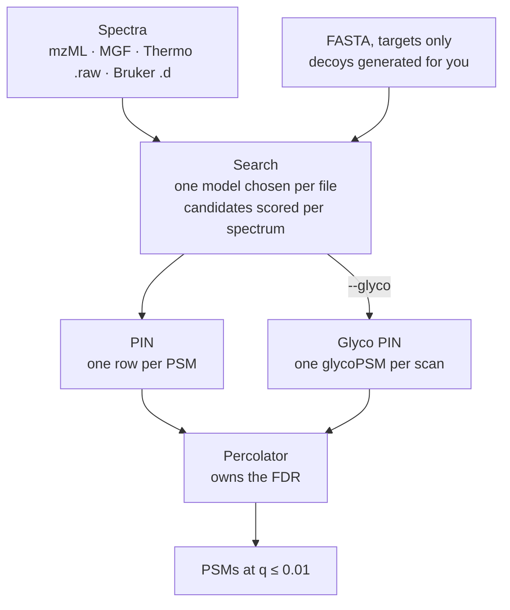

<br clear="left">

_The data-driven peptide search engine of the quantms ecosystem. Built and maintained by the quantms team._

[](https://github.com/bigbio/andes/actions/workflows/ci.yml)
[](https://github.com/bigbio/andes/releases)
[](LICENSE)

andes is a peptide database search engine for shotgun proteomics. Spectra (mzML, MGF, native
Thermo `.raw`, Bruker timsTOF `.d`) and a FASTA go in; a Percolator-ready `.pin` comes out. The
scoring model is picked per file from its metadata. Opt-in modes recover co-isolated peptides
(`--chimeric`), search secondary modifications (`--refine`) and identify intact
N-glycopeptides (`--glyco`). To our knowledge it is the first proteomics search engine designed
and built end-to-end with AI coding agents, under human direction.

## Identification benchmarks

PSMs on three public reference datasets for andes, Comet 2025.01 and Java MS-GF+ v20240326,
all rescored the same way. On low-res LFQ (UPS1), Java MS-GF+ reported 15,904 PSMs in an
earlier session.

| Engine | Astral (high-res HCD) | TMT a05058 (low-res CID) | UPS1 (low-res LFQ) |
|---|---:|---:|---:|
| andes `2051616b` (2026-10-23) | 52,169 | 13,516 | 16,225 |
| Comet 2025.01 (2026-10-05) | 31,435 | 10,504 | 14,734 |
| Java MS-GF+ v20240326 † | 26,542 | 10,651 | 15,904 |
| *andes wall time* | *114–117 s* | *40–47 s* | *30–48 s* |
| *Comet wall time* | *217 s* | *77 s* | *42 s* |

<sub>**Metric and provenance.** PSMs at Percolator `q ≤ 0.01`, one method for every row (plain
FASTA, andes `XXX_` decoys, Percolator 3.7.1 `--seed 42 -Y`, same 8-core VM, 8 threads); seeds 1
and 2 give andes counts within 1.2% of seed 42. With the current defaults (2 missed cleavages) and
an entrapment database, UPS1 reads 16,567–16,675 PSMs at `2ee76dd6` (2026-11-07); the benchmark
page reports that run. **†** Java MS-GF+ was not re-run; its counts are from an earlier session. **Error rates** (entrapment, three Percolator seeds; T/E measured per
database): andes's nominal 1% is 0.89–1.08% true FDP on Astral (peptide-level shuffled
entrapment), 0.67–0.76% on TMT a05058, 0.80–0.99% on phospho, and 0.92–0.94% on UPS1 against a
peptide-level shuffle (1.95–2.07% against the natural *E. coli* entrapment, of which about half
sits on proteins with a close yeast homolog; re-measured on 2026-11-07 at `2ee76dd6`). timsTOF, high-res TMT,
glyco and the full quantification results:
[`docs/benchmarks/`](docs/benchmarks/README.md); quantification summary below.</sub>

**Time, CPU and memory** (same VM, 8 threads, `/usr/bin/time`; andes 2026-10-23 at `2051616b`,
two runs on the standard sets, one on phospho; Comet 2026-10-06, one run, same rescoring).

| dataset | engine | PSMs @ q≤0.01 | wall | CPU time | peak memory |
|---|---|---:|---:|---:|---:|
| Astral | andes | 52,169 | 114–117 s | 569–636 s | 4.8 GB |
| | Comet 2025.01 | 31,435 | 217 s | 1,594 s | 8.1 GB |
| TMT a05058 | andes | 13,516 | 40–47 s | 200–216 s | 1.7 GB |
| | Comet 2025.01 | 10,504 | 77 s | 568 s | 2.9 GB |
| UPS1 | andes | 16,225 | 30–48 s | 162–166 s | 1.3 GB |
| | Comet 2025.01 | 14,734 | 42 s | 309 s | 2.9 GB |
| Phospho (PXD007653) | andes | 38,623 | 337 s | 2,160 s | 7.9 GB |
| | Comet 2025.01 | 33,984 | 1,096 s | 8,399 s | 6.0 GB |

<sub>Phospho is searched against mouse proteins with a whole-protein shuffled entrapment, the
database both rows used; Comet's count read 1.77% true FDP on that design, and andes's reads
0.80–0.99% on the peptide-level design that replaced it. Wall times vary 5–15% between sessions
(UPS1 30 and 48 s in two runs); CPU time is steadier.</sub>

## Quantification benchmarks

Label-free (`--lfq --mbr`) and TMT (`--tmt`) quantification on public designs with a known answer,
read through one evaluation for every tool (raw precursor intensities, the same normalisation,
roll-up and test for all). andes defaults at `09e1c00d` (label-free) and `0cfa03cc` (TMT),
2026-11-05; MaxQuant 2.7.0.0, FragPipe 21.1 / IonQuant 1.10.12 (normalisation off). Full tables,
settings and the cases where other tools do better:
[`docs/benchmarks/`](docs/benchmarks/README.md#quantification-truth-designs-match-between-runs-on-and-off).

One row per metric. 🟢 andes better · 🟡 similar · 🔴 andes worse, with how much: **minor** (usable
as is), **moderate** (usable with care), **major** (results hurt). ⚪ no other tool measured. DE counts
are the common-tested family, sign-aware, MBR on.

| data | metric | andes | MaxQuant 2.7 | FragPipe | result |
|---|---|---:|---:|---:|---|
| ProteoBench QE | median \|ε\| (lower is better) | 0.161 | 0.210 | 0.200 | 🟢 23% / 20% lower |
| ProteoBench QE | precursors in ≥ 3 runs | 63,796 | 44,299 | 63,701 | 🟢 +44% / 🟡 same |
| ProteoBench QE | CV | 0.117 | 0.219 | 0.156 | 🟢 47% / 25% lower |
| ProteoBench Astral | median \|ε\| | 0.186 | 0.160 | 0.212 | 🔴 1.16x MaxQuant at 55% of andes' depth (minor) / 🟢 12% lower |
| ProteoBench Astral | precursors in ≥ 3 runs | 36,675 | 20,283 | 39,057 | 🟢 +81% / 🟡 6% fewer |
| ProteoBench Astral | CV | 0.112 | 0.092 | 0.127 | 🔴 1.2x MaxQuant at 55% of andes' depth (minor) / 🟢 12% lower |
| Truth designs, 8 sets | precursors quantified, each tool at its own search settings | 10.7k–93.6k | | | 🟢 +19% to +51% on 7 sets, 🟡 on 1 |
| PXD009740 / PXD009815 / QE / Astral | precursors quantified, andes at matched search settings (no `--chimeric`, no `--refine`) | 27,226 / 29,600 / 81,987 / 51,798 | 29,293 / 27,459 / 51,609 / 24,745 | 25,888 / 28,286 / 71,377 / 46,347 | 🟡 −7% / 🟡 +5% / 🟢 +15% / 🟢 +12% over the best other tool |
| PXD009740 / PXD009815 / QE / Astral | DE true positives | 1,300 / 844 / 1,047 / 685 | 1,304 / 844 / 857 / 650 | 1,237 / 849 / 946 / 689 | 🟡 / 🟡 / 🟢 +22% / 🟡 |
| PXD009740 / PXD009815 / QE / Astral | DE false calls, no fold-change cut | 305 / 153 / 110 / 296 | 129 / 92 / 37 / 210 | 302 / 301 / 43 / 389 | 🔴 1.4–3.0x MaxQuant (moderate); mostly real small shifts, see note |
| PXD009740 / PXD009815 / QE | DE false calls at \|log2 FC\| ≥ 0.5 (seed 42) | 167 / 39 / 11 | 74 / 36 / 18 | 259 / 102 / 20 | 🔴 2.3x / 🟡 / 🟢 |
| PXD009740 / PXD009815 / QE / Astral | DE true positives / false calls, MaxQuant matches filtered at q ≤ 0.01 | 1,156 / 763 / 983 / 568; 272 / 151 / 105 / 297 | 1,077 / 725 / 851 / 518; 131 / 62 / 42 / 154 | | 🟢 +5% to +15% true positives; 🔴 1.9–2.5x false calls (moderate) |
| PXD009740 / PXD009815 / QE / Astral | precision of unchanged proteins (within-condition spread, tool ÷ andes) | 1 | 1.15 / 1.55 / 1.26 / — | 1.40 / 1.30 / 1.25 / — | 🟢 tighter than both |
| UPS1 lowest 3 levels, PXD009740 / PXD009815 | precursors within 2x of truth | 502 / 24 | 417 / 23 | 458 / 50 | 🟢 as reported, 🔴 at FragPipe's row count (437 against 458) / 🔴 2x fewer than FragPipe (minor) |
| Truth designs, all sets | bright identified cells off by > 2x | 1.8–7.2% | 0.3–1.6% | 0.3–3.8% | 🔴 3–17x MaxQuant per set (moderate) |
| Truth designs, 6 sets | protein CV | 4.4–10.1% | 7.0–11.6% | 4.9–13.5% | 🟢 on 3 sets, 🔴 on 2 (minor) |
| Known-absent yeast, PXD014415 | false-transfer rate | 0.20% (0.08% at `quant_q ≤ 0.01`) | | 0.09% | 🔴 2x at default (minor) |
| Blank run, PXD016921 | rows identified in the blank | 0 on current main (85 at `09e1c00d`) | 20 | 8 | 🟢 fewest |
| Blank run, PXD016921 | rows transferred into the blank | 0, not attempted | 85 unfiltered (9 at `Match q-value ≤ 0.01`) | 0, not scored | ⚪ not tested: andes and FragPipe make no transfer decision |
| TMT knockout, PXD017803 hrMS2 | interference (lower is better) | 0.192 (0.000 with `--tmt-unmix on`) | 0.156 | | 🔴 default, 🟢 with the option |
| TMT known ratios, PXD007683 | PSMs | 149,121 | 97,107 | | 🟢 +54% |
| TMT known ratios, PXD007683 | protein ratio error | 0.213 | 0.159 | | 🔴 1.3x (moderate) |
| TMT match between runs, PXD014750 | excess wrong-value rate of transfers | −0.05 points | +1.53 | | 🟢 (SIMSI-Transfer +0.40) |
| TMT match between runs | cells transferred | 3,636 | | | 🔴 4.5x fewer than SIMSI-Transfer (minor, opt-in) |
| Large study, PXD042233 (500 runs) | precursors in ≥ 3 runs | 243,895 | | | ⚪ |

ProteoBench rows use the MaxQuant and FragPipe leaderboard submissions with the most precursors
(MaxQuant 1.5.3.30 on QE, 2.6.7.0 on Astral; FragPipe 23.0); every other submission is on the
[benchmark page](docs/benchmarks/README.md).

Note on DE false calls: andes' protein values are tighter than the other tools', so small real
shifts of the "unchanged" species reach significance. On PXD009740, 296 of 320 false calls (seed
42 on current main; 305 in the table, mean over seeds at `09e1c00d`) are against its highest UPS1
level; without that level andes has 955 true positives and 24 false calls
against MaxQuant's 953 and 31. Analysis on the [benchmark page](docs/benchmarks/README.md).

<sub>DE: proteins with ≥ 2 precursors tested by every tool of the set, moderated t, Benjamini–Hochberg
5%. Knockout interference rests on 26–91 knockout PSMs per value, so read it as a direction.
Identifications reuse the 2026-10-31 searches. The open problems are the DE false positives on
UPS1 designs, the gross error of bright identified cells and the false-transfer rate at the default
threshold.</sub>

## How it works



1. **Pick the model** from the file's activation, resolution and isobaric label (one of 19
   bundled models). With several `--spectrum` inputs the model comes from the first one; an
   input of the other fragment resolution class stops the search, any other difference in
   analyzer or activation is reported.
2. **Build candidates**: digest the FASTA and generate decoys. A FASTA that already holds
   decoys (reversed records, or records named as the decoy of another record) stops the search:
   pass targets only, or declare them with `--decoy-prefix <tag> --decoy-strategy none`. The candidate index goes
   out-of-core (cached in `--index-cache-dir`, by default next to the output) so candidates can be retrieved by the
   fragment-ion index; on low-res data only the 150 most intense peaks of each spectrum vote.
   `--glyco` builds its own sequon-only candidate table from the same out-of-core index.
3. **Score**: low-res by the generating-function rank score, high-res by the fused strong
   score, plus GBDT fragment-intensity features. High-res searches score only the 100 candidates
   whose fragment ions best match the spectrum (Astral: +22% PSMs at an equal true FDP; phospho:
   164 s instead of 99 minutes).
4. **Optional passes** `--chimeric`, `--refine` and the separate `--glyco` pipeline (below).
5. **Rescore** with Percolator, run by you or by `--rescore`. andes computes no production FDR.
6. **Quantify** the confident PSMs on request: reporter ions (`--tmt`) or MS1 features (`--lfq`).

Full parameter reference: [`DOCS.md`](DOCS.md).

## Install

**Option 1 — [release archive](https://github.com/bigbio/andes/releases)** (recommended):

```
andes-<version>-x86_64-unknown-linux-gnu.tar.gz
andes-<version>-aarch64-unknown-linux-gnu.tar.gz
andes-<version>-x86_64-apple-darwin.tar.gz
andes-<version>-aarch64-apple-darwin.tar.gz
andes-<version>-x86_64-pc-windows-msvc.zip
```

Each archive holds the binary, the 19-model store in `resources/models/`, and LICENSE/NOTICE/README.

**Option 2 — `cargo install`:**

```bash
cargo install --git https://github.com/bigbio/andes --bin andes
```

**Option 3 — build from source:**

```bash
git clone https://github.com/bigbio/andes
cd andes
cargo build --release
# Binary: target/release/andes
```

Requires Rust 1.85+ (see `rust-toolchain.toml`).

## Quick Start

```bash
andes \
  --spectrum spectra.mzML \
  --database proteins.fasta \
  --output-pin out.pin
```

This runs a tryptic search with no configuration: for mzML, `.raw` and `.d` the model is chosen
from the file metadata, and the precursor tolerance defaults to `20ppm`. Feed `out.pin` to
Percolator for q-values.

> **MGF has no instrument metadata.** andes reads the fragment resolution from the peaks of the
> first 1,000 spectra (13C isotope pairs at 1.00335/z within 10 ppm, compared with chance) and
> selects the high-res HCD model when they show high resolution. When the peaks do not decide it
> assumes CID / low-res / 0.5 Da and warns. `--fragmentation <CID\|ETD\|HCD\|UVPD>` and
> `--fragment-tol-ppm` / `--fragment-tol-da` override the inference.

Each PIN row is one PSM. `RankScore` orders candidates within a spectrum; `RawScore` is the
score Percolator weights most. All columns are in [`DOCS.md` §3a](DOCS.md#3a-pin-columns).
The final tolerances and a per-modification PSM tally go to stderr and `<stem>.statistics.log`
([`DOCS.md` §3d](DOCS.md#3d-run-summary-stemstatisticslog)).

## Common workflows

**Tryptic DDA + Percolator** (default):

```bash
andes --spectrum spectra.mzML --database db.fasta --output-pin out.pin
docker run --rm -v $(pwd):/data biocontainers/percolator:v3.7.1_cv1 \
  percolator -X /data/weights.txt /data/out.pin
```

**Modifications** are UNIMOD names with their sites, as in MaxQuant (format:
[`DOCS.md` §2](DOCS.md#2-modifications)). The defaults are fixed Carbamidomethyl (C) and
variable Oxidation (M) and Acetyl (Protein N-term); a list replaces its default:

```bash
andes \
  --spectrum tmt_spectra.mzML \
  --database hsapiens.fasta \
  --output-pin out.pin \
  --fixed-mods "Carbamidomethyl (C), TMT6plex (K), TMT6plex (N-term)" \
  --variable-mods "Oxidation (M), Phospho (STY)" \
  --protocol TMT
```

Neutral losses, cleavage blocking, diagnostic ions, annotated-only sites and custom masses are
set per modification in the config file (`--config`).

**UniProt XML database.** `--database uniprot_sprot_human.xml.gz` searches like the UniProt
FASTA. It also offers opt-in uses of UniProt's annotation. A mod declared
`restrict_to: annotated` in the config file is placed only where UniProt annotates that
modification.
`--uniprot-variants` searches natural sequence variants as their own entries, with the change in
the accession. `--uniprot-isoforms` adds the described isoforms, and `--uniprot-chains` the
peptides at the new termini of mature chains (after signal peptide or propeptide removal).
Annotation is filtered by evidence (`--uniprot-evidence`); see
[`DOCS.md` §1a](DOCS.md#uniprot-xml-databases). With rescoring, variant calls are checked
against knockoff variants ([below](#variant-calls-checked-against-knockoffs---knockoffs---proteoform-fdr)).

```bash
andes --spectrum spectra.mzML --database uniprot_sprot_human.xml.gz \
  --config phospho_annotated.yaml --uniprot-variants --output-pin out.pin
```

**PEFF databases.** `--database x.peff` reads a PSI Extended FASTA file. Its variant,
modification and processing header keys become claims built like UniProt's
([`DOCS.md` §1a](DOCS.md#peff-databases)).

**Site claims (experimental).** Annotated modification sites are checked against knockoff
sites: the same modification on matched residues no annotation names. With rescoring, each site
gets a site q-value and `<stem>.sites.tsv` lists the accepted ones. The estimate errs towards
rejecting true claims; it is most useful with freely placed mods
([`DOCS.md` §1a](DOCS.md#site-claims-knockoff-sites-experimental)). Each site also gets its
occupancy and the probability of each modification it may carry (acetyl 0.71, trimethyl 0.29),
from the competing explanations of each spectrum, diagnostic ions and neutral losses
([`DOCS.md`](DOCS.md#site-identity-occupancy-and-which-modification)).

**Annotation files.** `--annotations claims.annotations.parquet` adds claims about the proteins
of any database, FASTA included: sequence edits (variant entries), modification sites, mature
chains. The claims can come from variant catalogues, a sample's own variant calls or site
databases, one row per claim, with a checksum of the sequence each was written against. They are
built into entries exactly like UniProt's own, so knockoffs, the class FDR and the proteoform table
apply unchanged. The flag can be repeated, and equal claims are merged. The columns are listed in
[`DOCS.md` §1a](DOCS.md#annotation-files---annotations).

```bash
andes --spectrum spectra.mzML --database human.fasta \
  --annotations cosmic.annotations.parquet --annotations sample.annotations.parquet \
  --rescore --output-pin out.pin
```

**TSV and Parquet output:**

```bash
# TSV for inspection; QPX .idparquet bundle for quantms
andes --spectrum spectra.mzML --database db.fasta \
  --output-pin out.pin --output-tsv out.tsv --output-parquet out.idparquet
```

**In-process rescoring.** `--rescore` runs Percolator (`--percolator-bin`, else `percolator` on
`$PATH`, else the pinned Docker image). `--rescore-native` is a built-in
cross-validated semi-supervised linear rescorer with target-decoy competition (Percolator's
algorithm, as `-Y`), a fallback when Percolator is not available. Both add a q-value and PEP to the outputs and write `<stem>.q<fdr>.tsv` (targets at
q ≤ `--psm-fdr`, default 0.01, e.g. `--rescore --psm-fdr 0.01`). `--psm-fdr` and `--pep` do nothing
without one of them.

**Protein groups.** Every rescored run also writes `<stem>.protein_groups.tsv`: protein groups
by parsimony over protein families (a canonical entry with its isoform, variant and chain
entries is one family), each with a protein q-value from picked target-decoy competition.
`--protein-fdr 0.01` keeps only PSMs of groups at that level in the filtered TSV, and only their
families in the proteoform table; no quantification is needed
([`DOCS.md`](DOCS.md#protein-groups-and-protein-fdr)).

**Quantification (`--tmt`, `--lfq`).** andes quantifies the confident PSMs in the same run:
`--tmt tmt10` reads the reporter ions of every identified MS2 (or its SPS-MS3 with
`--tmt-level 3`), applies the kit's impurity matrix (`--tmt-correction`) and reports the
precursor isolation purity; `--lfq` integrates the isotope chromatograms of every identified
precursor from the MS1 scans with an experimental decoy-based feature q-value estimate. Both write
versioned Parquet tables (`<stem>.tmt.parquet`, `<stem>.lfq.parquet`) and, with `--output-parquet`, the QPX
`quantms.feature.parquet` that quantms consumes. Normalization and protein roll-up stay
downstream ([`DOCS.md` §10](DOCS.md#10-quantification)). `--lfq --mbr` adds match between runs
over two or more inputs: every confident precursor is measured in every run, and transfers carry
an internal quant-quality q-value (`<stem>.mbr.parquet`). The same stages run one at a time with
`andes quant library|extract|finalize` over a `--quant-dir`, for pipelines that spread runs
over machines. On the ProteoBench label-free DDA modules (six runs each; measured 2026-11-05 at
`09e1c00d` with default settings), andes quantified 63,796 precursors in at least 3 runs on
QExactive (PXD028735) at transfer q 0.01, with a median |ε| of 0.161 and a CV of 0.117 using
`quantity_normalized` (52,166 at 0.154 / 0.105 with the transfers left out; 71,299 at q 0.05; the
default is 0.01; the raw quantity reads |ε| 0.222, CV 0.245). On the same module FragPipe 23.0
reports 63,701 at 0.200 / 0.156 and Sage 0.15.0-beta.2 81,933 at 0.388 / 0.393, without filtering
transferred quantities. On Astral (PXD070049) andes quantified 36,675 at |ε| 0.186 and CV 0.112
(31,739 at 0.186 / 0.100 without transfers); FragPipe 23.0 reports 39,057 at 0.212 / 0.127, Sage
0.14.6 30,319 at 0.167 / 0.070 and DIA-NN 2.6.0 93,237 at 0.277 / 0.159. Leaderboard snapshot
2026-07-16, one andes seed. On a 500-run study (PXD042233, measured 2026-10-23 at `2051616b`) the
per-run pipeline took 146 CPU hours end to end and quantified 243,895 precursors in at least 3
runs ([benchmarks](docs/benchmarks/README.md#2-the-benchmarks)). Quantification against truth
designs, with and without match between runs and next to MaxQuant and FragPipe, and the TMT
comparisons are in the same report.

```bash
andes --spectrum tmt_run.mzML --database human.fasta \
      --rescore --tmt tmt10 --tmt-correction lot.txt --output-parquet run.idparquet
andes --spectrum run1.mzML --spectrum run2.mzML --database human.fasta --rescore --lfq
andes --spectrum run1.mzML --spectrum run2.mzML --database human.fasta --rescore --lfq --mbr
```

**[quantms](https://github.com/bigbio/quantms).** Point the search step at `andes`. Use named
flag values; legacy numeric values are rejected ([`DOCS.md` §8](DOCS.md#8-legacy-numeric-values--behavior-notes)).

## Selecting the scoring model

andes picks a model by `(activation, instrument, enzyme, protocol)`, automatically for mzML,
`.raw` and `.d`. `--fragmentation` is needed only for MGF; `--protocol
<auto\|TMT\|iTRAQ\|iTRAQ-phospho\|phospho\|standard>` selects a labelled or enriched model;
`--model <slug>` loads one model by id (e.g. `hcd_qexactive_tryp_tmt`). The enzyme comes from
`--enzyme` (default trypsin). An uncovered regime uses the nearest model.

### Supported models

All 19 models are trained by andes on public PRIDE data; the store contains no MS-GF+-derived
model data.

| `model_id` | activation / instrument / enzyme / protocol | Training data (public PRIDE) | Benchmark |
|---|---|---|---|
| `hcd_astral_tryp` | HCD / OrbitrapAstral / Trypsin / Automatic | PXD046453 | Astral |
| `hcd_qexactive_tryp` | HCD / QExactive / Trypsin / Automatic | PXD009875, PXD028735, PXD061135 | global default model |
| `hcd_qexactive_tryp_tmt` | HCD / QExactive / Trypsin / TMT | PXD010429, PXD017092 | — |
| `hcd_qexactive_tryp_itraq` | HCD / QExactive / Trypsin / iTRAQ | PXD002214, PXD003702 | — |
| `hcd_qexactive_tryp_phosphorylation` | HCD / QExactive / Trypsin / Phosphorylation | PXD007740, PXD014525, PXD019646 | — |
| `hcd_highres_tryp_tmt` | HCD / HighRes / Trypsin / TMT | PXD016766 | — |
| `hcd_highres_nocleavage` | HCD / HighRes / NoCleavage / Automatic | PXD004894, PXD006939 | — |
| `hcd_highres_nocleavage_phosphorylation` | HCD / HighRes / NoCleavage / Phosphorylation | PXD004894, PXD006939 | — |
| `cid_lowres_tryp` | CID / LowRes / Trypsin / Automatic | PXD009875 + PXD000865 | UPS1 (low-res) |
| `hcd_lowres_tryp` | HCD / LowRes / Trypsin / Automatic | ion-trap HCD scans (ITMS, hcd) of PXD056948, PXD063913, PXD067562, PXD072063 | HCD on ion trap PXD012131, PXD033117, PXD042919, PXD023374 |
| `cid_lowres_tryp_tmt` | CID / LowRes / Trypsin / TMT | PXD016999 + PXD014502 + PXD017092 | TMT a05058 (low-res) |
| `cid_lowres_lysc` | CID / LowRes / LysC / Automatic | PXD000900 | ⚠ limited training data |
| `cid_lowres_argc` | CID / LowRes / ArgC / Automatic | PXD000900 | ⚠ limited training data |
| `cid_lowres_gluc` | CID / LowRes / GluC / Automatic | PXD000900 | ⚠ limited training data |
| `ethcd_qexactive_tryp` | EThcD / QExactive / Trypsin / Automatic | ProteomeTools EThcD/ETciD scans (PXD004732, PXD010595) | EThcD PXD010154, PXD023835; HLA EThcD PXD064573 (non-specific route) |
| `etd_highres_tryp` | ETD / HighRes / Trypsin / Automatic | PXD004732, PXD010595 | — |
| `etd_highres_tryp_phosphorylation` | ETD / HighRes / Trypsin / Phosphorylation | PXD007058 | — |
| `etd_lowres_tryp_phosphorylation` | ETD / LowRes / Trypsin / Phosphorylation | PXD019646 | — |
| `uvpd_qexactive_tryp` | UVPD / QExactive / Trypsin / Automatic | PXD003109, PXD018176, PXD065289 | — |

<sub>Training data: the PRIDE accessions in each model's `dataset` field in `resources/models/`.
**⚠ limited training data:** few PSMs were available, so treat these models as best-effort.</sub>

To train your own, see [`TRAIN.md`](TRAIN.md).

## Chimeric / co-isolated peptides (`--chimeric`, experimental)

With `--chimeric` (mzML or Thermo `.raw`), pass 1 is the normal search, keeping the same top-N
candidates per scan (`--top-n`, default 10); pass 2 takes the best one as the primary peptide,
finds co-isolated precursors in the MS1 isolation window and searches the residual spectrum for
a second peptide. Keeping the alternatives (rather than only the best candidate) took Astral from
60,435 to 66,405 PSMs and 26,717 to 29,400 peptides at an equal entrapment true FDP of 1%. On
phospho the alternatives first cost about 1% of peptides (15,084 → 14,904): most of them were the
same phosphopeptide with the phosphate on another site. The PIN now keeps one row per peptide and
modification multiset per precursor (see [DOCS.md](DOCS.md) §3a), and phospho with `--chimeric`
reaches 39,470–39,592 PSMs and 15,107–15,156 peptides, above top-1 (39,404–39,489 / 15,046–15,084).

On UPS1 (with entrapment) PSMs at q ≤ 0.01 rose from 15,838 to 17,112 (+8.0%) with entrapment
hits flat (166 → 167). On high-res data `--chimeric` runs on the default out-of-core path with
fragment-ion retrieval. On Astral with an entrapment database (Percolator, three seeds), at an
equal 1% true FDP, it gives 66,377–66,424 PSMs against 43,076–43,145 without `--chimeric`
(+54%) and 29,384–29,400 distinct peptides against 26,723–26,746 (+10%); measured 2026-10-05 to
2026-10-13 on earlier builds. The true FDP at nominal q ≤ 0.01 was measured only with one
candidate kept per scan in pass 1 (1.18%, against 1.05% without `--chimeric`), not with the
alternatives kept.

## Secondary modifications (`--refine`, experimental)

`--refine` searches the spectra pass 1 missed against confident proteins with a fixed tier of
five chemistries (oxidation, deamidation, two pyro-Glu losses, protein N-terminal acetyl). It
does not discover new modifications and runs on high-resolution data only. On Astral it gives
40,028 PSMs (+4.3%), but its Pass-2 PSMs (`IsRefinement = 1`) sit at **~2.8% FDP** under a
merged 1% threshold; threshold them separately for 1% on modified PSMs ([`DOCS.md`](DOCS.md#refine--secondary-chemistry-cascade)).

## Variant calls checked against knockoffs (`--knockoffs`, `--proteoform-fdr`)

**Aim.** A PSM on a UniProt variant entry claims that the sample carries that variant. Most false
claims are not random matches. They are a canonical peptide that a common modification or an
isotope error makes look like the variant: N→D and Q→E look like deamidation, G→A and D→E like
methylation, and a one-isotope mis-pick fits a +1 Da substitution. Decoys model only random
matches, so a decoy-based q-value does not see this error. Measured against donor genotypes, 65%
of the variant PSMs accepted at a class q-value ≤ 0.01 were variants no donor carries, and 96% of
the deamidation-like ones were. Knockoff variants give the variant claim a null that makes the
same mistakes.

**How it works.**
1. **Knockoff entries.** Each single-residue variant X→Y of a canonical sequence, from
   `--uniprot-variants` or `--annotations`, gets up to `--knockoffs` (default 4) knockoff entries. A knockoff is the same
   substitution at another position of the same sequence that holds X, where:
   - the next residue matches: the same residue when X is N, Q, K or R or either next residue is
     P or G, otherwise the same residue class;
   - the N-x-S/T sequon status is the same;
   - the position lies in another enzymatic span whose length is within 3 residues of the real
     one's and between 6 and 50;
   - every variant UniProt lists for the protein is at least 10 residues away.

   The positions are chosen at random but reproducibly, from the accession and the variant id.
   A knockoff is almost certainly absent from the sample. A modification or an isotope error that
   mimics the real substitution mimics the knockoff equally well. Knockoffs are variant entries:
   they get decoys, PIN flags and Percolator scores exactly like real variants
   (`sp|P04637_KO1_D21H_VAR_005851_D7H|P53_HUMAN` moves `VAR_005851_D7H` to position 21).
2. **Knockoff q-value.** After Percolator and the class FDR, variant-class PSMs are split by
   substitution class (deamidation-like, methyl-like, oxidation-like, other). Within a class, the
   knockoff PSMs above a score estimate how many real variant PSMs above it are false. A knockoff
   PSM counts 1/k for a variant with k knockoffs, and the estimate starts at 1/K for a finite-sample
   margin, with K the most knockoffs any variant has:

   FDP(t) = (1/K + Σ 1/k over knockoff PSMs ≥ t) / (real PSMs ≥ t whose variant has knockoffs)

   A real PSM's knockoff q-value is the smallest FDP over the thresholds at or below its score. Its
   reported q-value is the largest of the global, class and knockoff q-values.
   With claims from several sources, each substitution class is split further by prior tier
   (`sample`, `common`, `curated`, `catalogue`; see
   [`DOCS.md` §1a](DOCS.md#annotation-files---annotations)), so a sample's own variants and
   catalogue variants do not share one estimate.
3. **Untested variants.** A variant with no position that qualifies for a knockoff has no null, so
   its PSMs are not accepted. Measured against genotypes, those variants are false several times
   more often than the tested ones, so the tested variants' estimate cannot be lent to them.
4. **Reporting.** Variant-class PSMs (every protein a variant entry) are accepted at
   `--proteoform-fdr`, every other PSM at `--psm-fdr`. Knockoff PSMs stay in the PIN as targets; they
   are left out of the QPX bundle. They are never in the filtered TSV, quantification, MBR or the
   proteoform table, and knockoff accessions are dropped from other rows' protein lists.

**Input and parameters.** Variants from a UniProt XML database (`--uniprot-variants`) or from
annotation files (`--annotations`), and `--rescore`.

| Flag | Default | Effect |
|---|---|---|
| `--knockoffs` | `4` | Knockoffs per single-residue variant. `0` turns them off and leaves variant PSMs to the class FDR alone. |
| `--proteoform-fdr` | the larger of `--psm-fdr` and 0.05 | q-value cutoff for variant-class PSMs in the filtered TSV, the proteoform table and quantification. |
| `--uniprot-evidence` | `experimental` | Minimum evidence for a variant to be searched (`curated` was used below). |

The run log gives, per substitution class, the knockoff entries made, the variant PSMs accepted
before and after the knockoff q-values, how many were tested, and the estimated false share:

```
UniProt XML: 39142 knockoff variant entries (44773 single-residue variants with no position for a knockoff)
Rescore: variant PSMs at q<=0.05 per substitution class, before -> after knockoff q-values:
  deamidation-like 1201 -> 0 (147 tested; knockoffs 150.6, false share 1.02), methyl-like 212 -> 89 ...
```

```bash
andes --spectrum run1.mzML --spectrum run2.mzML --database uniprot_sprot_human.xml.gz \
  --uniprot-variants --uniprot-evidence curated --rescore --output-pin variants.pin
```

**Current benchmark.**

*Genotype truth.* PXD022787 (four donors, one TMT10 set, 69 runs, ion-trap MS2) was searched
against reviewed human UniProt with curated variants. The donor-haplotype tags of the personal
protein FASTA deposited with the dataset label each reported variant as carried or absent. The
true FDP below counts the labelled PSMs whose variant no donor haplotype carries:

| Setting | Variant PSMs reported | Absent / labelled | True FDP | Variants reported (true FDP) |
|---|---|---|---|---|
| No knockoffs, class q ≤ 0.01 | 2,452 | 1,075 / 1,653 | 65% | 552 (33%) |
| No knockoffs, class q ≤ 0.05 | 3,886 | 1,872 / 2,622 | 71% | 840 (45%) |
| Knockoffs, `--proteoform-fdr 0.05` | 201 | 4 / 160 | **2.5%** | 83 (3.4%) |
| Knockoffs, `--proteoform-fdr 0.10` | 307 | 14 / 233 | **6.0%** | 126 (8.2%) |

Only 0.55% of the knockoffs turned out to be a real donor variant, so the null is clean.

*Prior tiers.* The same EN-TEx runs were searched against a FASTA of reviewed human UniProt plus
an annotation file holding UniProt's 83,472 single-residue variants. In one arm, the variants a
donor carries were given a sample genotype (tier `sample`), as a sample's own variant calls
would be. In the other, every variant was in one tier. At `--proteoform-fdr 0.05`:

| Setting | Carried variant PSMs (variants) | Donor-absent PSMs (variants) | True FDP, PSMs | True FDP, variants |
|---|---|---|---|---|
| One tier | 218 (83) | 13 (7) | 5.6% | 7.8% |
| Tiers split | 329 (122) | 8 (3) | 2.4% | 2.4% |

Separate tiers recover half again as many carried variants and stay below the 5% target, which
one shared tier does not. A variant peptide that a reference protein holds once I and L are taken
as equal (for example a V→L variant spelling a paralog's `…VIDEVR` as `…VLDEVR`) is reported for
that reference, not as the variant. Without that step, one such tubulin peptide alone gave 42
false variant PSMs here.

*Cost on the rest of the search.* Knockoffs grow the variant entries by about 60%. PSMs at
q ≤ 0.01 change by −0.43% on pooled Astral DDA (PXD070049, 21 runs: 1,003,367 → 999,103) and by
−0.30% on the TMT set. Search time is unchanged. On the Astral set, 129 variant-class PSMs are
reported at `--proteoform-fdr 0.05`.

**Limits.**
- About 30% of single-residue variants can be given a knockoff, so most variants are not reported.
- Multi-residue variants, indels, isoform-borne variants, isoforms and mature chains get no
  knockoffs. Variant-class PSMs of those are not accepted while knockoffs are on; isoform and
  chain PSMs keep the class FDR.
- The calibration is measured on one genotyped dataset with low-resolution MS2. Small counts
  make the deamidation- and oxidation-like classes the least certain.

## Intact N-glycopeptide search (`--glyco`, experimental)

`--glyco` identifies the backbone and the glycan composition from one MS2 scan.

```bash
andes --spectrum sample.mzML \
      --database proteins.fasta \
      --decoy-strategy sequon \
      --glyco --glyco-species human \
      --output-pin results.pin
```

- A glycan database is required: `--glyco-species` (`human`, `mouse`,
  `mouse-large`, `high-mannose`) or your own `.gdb` with `--glyco-glycan-gdb`.
- Output is only `results.glyco.pin`; `--output-tsv`, `--output-parquet`, `--rescore` and
  `--refine` are rejected. Run Percolator on it with `--trainFDR 0.05`.
- Use `--decoy-strategy sequon`; the other generated decoys carry fewer sequons than their targets,
  which makes q-values anti-conservative.
- Search each fraction separately, concatenate the `.glyco.pin` files (one header) and run
  Percolator once: one fraction has too few decoys for a stable 1%.
- HCD/CID and ETD/EThcD/AI-ETD are supported; c/z fragments localize the glycosite. The site is
  reported as `@N<pos>` only for a single N-X-S/T sequon, otherwise `@N?`.

On one mouse-liver fraction (PXD005553) andes reports 6,992–7,072 glycoPSMs at 1% at
0.61–1.35% true FDP (three peptide-level entrapment databases × three seeds, 2026-10-23),
confirming 88.2–88.4% of the depositors' (pGlyco2) and 89.3–89.7% of a reanalysis's
(MSFragger-Glyco) identifications, in about 6 minutes and 5.6 GB on 8 threads ([`docs/benchmarks/`](docs/benchmarks/README.md)).
`--glyco-peptide-first` finds ~2% more at ~13x the run time.

Memory: `--glyco` runs on the out-of-core candidate index and holds in memory only the
candidates that carry an N-X-S/T sequon (3.2 of 28.0 million on the mouse fraction above), so
that run peaks at 4.5 GB with output identical to the former in-RAM path (20.0 GB). All flags:
[DOCS.md §9](DOCS.md#9-glycopeptide-search-experimental--advanced-knobs).

## Reading Thermo `.raw` files

Pass `--spectrum sample.raw`. Output is identical to the equivalent mzML (checked scan-for-scan
on a 2.4 GB Orbitrap Astral run). Release archives (macOS x64/arm64, Windows x64, Linux x64)
bundle a .NET 8 runtime. From source, install the
[.NET 8 runtime](https://dotnet.microsoft.com/download/dotnet/8.0) and build with rustc ≥ 1.88:
`RUSTUP_TOOLCHAIN=stable cargo build --release -p andes --features thermo`.

andes uses a bundled `dotnet/` next to the binary, else `DOTNET_ROOT` or a system install;
containers can start from `mcr.microsoft.com/dotnet/runtime:8.0`. RawFileReader is under
Thermo's license (`crates/input/THERMO_LICENSE.txt`).

## Reading Bruker timsTOF `.d` files

Pass `--spectrum sample.d` (a directory), or the run as an archive (`sample.d.zip`,
`sample.d.tar`, `sample.d.tar.gz`, `sample.d.tgz`, `sample.d.gz`), which is unpacked into
`--temp-dir` for the run. The pure-Rust [`timsrust`](https://crates.io/crates/timsrust)
reader needs no vendor runtime; build with `--features timstof` (rustc ≥ 1.88):

```bash
cargo build --release -p andes --features timstof
andes --spectrum sample.d --database human.fasta --output-pin out.pin
```

Scope: DDA-PASEF. Each precursor gives one MS2 spectrum, summed over all its PASEF
selections, centroided and converted to m/z with the run's calibration. The MS1 survey frames
are read too (centroided and m/z-calibrated per run against the instrument's precursor
records), so `--lfq`, `--quant-dir`, `--mbr`, `--chimeric` and `--precursor-cal` run on `.d`
input. The search reads MS1 summed over ion mobility; quantification reads it resolved by ion
mobility and measures each precursor within a mobility window around its identifications'
1/K0 (width learned per run), so a co-eluting ion at the same m/z and another mobility stays
out of its traces. Ion mobility is not scored. A TDF holds no MS3 scans, so `--tmt-level 3` is an
error (reporters are read from the MS2). Runs written with the frame compression of early
acquisition software (TDF compression type 1) are not readable; convert them to mzML.

## Citation

If you use andes in published work, please cite:

> bigbio (2026). andes: a data-driven peptide search engine for the quantms ecosystem. https://github.com/bigbio/andes

## License

andes is released under the **Apache License 2.0** — see [`LICENSE`](LICENSE) for the full text and [`NOTICE`](NOTICE) for attribution.
