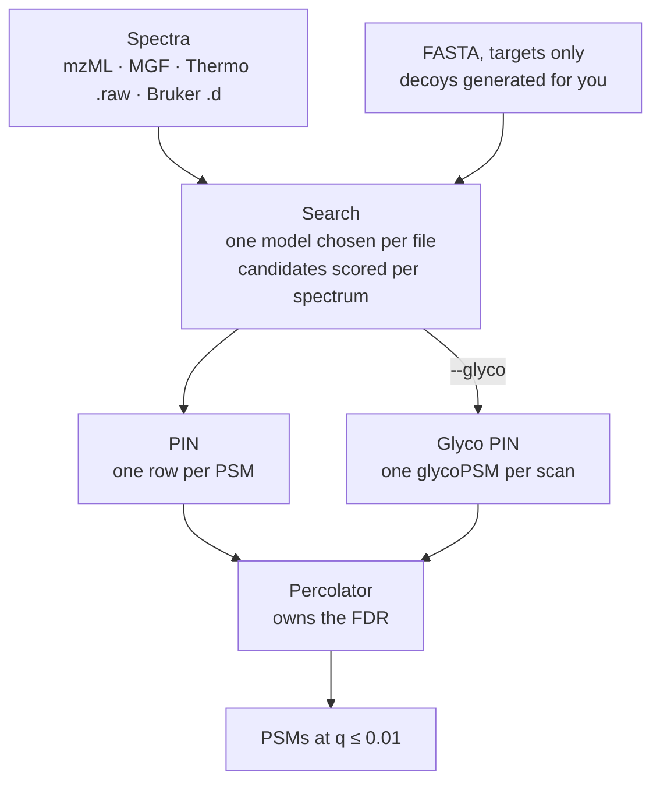

<br clear="left">

_The data-driven peptide search engine of the quantms ecosystem. Built and maintained by the quantms team._

[](https://github.com/bigbio/andes/actions/workflows/ci.yml)
[](https://github.com/bigbio/andes/releases)
[](LICENSE)

andes is a peptide database search engine for shotgun proteomics. Spectra (mzML, MGF, native
Thermo `.raw`, Bruker timsTOF `.d`) and a FASTA go in; a Percolator-ready `.pin` comes out. The
scoring model is picked per file from its metadata. Opt-in modes recover co-isolated peptides
(`--chimeric`), search secondary modifications (`--refine`) and identify intact
N-glycopeptides (`--glyco`). To our knowledge it is the first proteomics search engine designed
and built end-to-end with AI coding agents, under human direction.

## Why andes?

andes finds more PSMs than a widely used open-source search engine (engine K) on all three
reference datasets. On low-res LFQ (UPS1), Java
MS-GF+'s strongest regime, it trails Java.

| Engine | Astral (high-res HCD) | TMT a05058 (low-res CID) | UPS1 (low-res LFQ) |
|---|---:|---:|---:|
| **andes** | **47,080** | **12,347** | 15,848 |
| engine K | 31,435 | 10,504 | 14,734 |
| Java MS-GF+ v20240326 † | 26,542 | 10,651 | **15,904** |
| *andes wall time* | *160–161 s* | *28 s* | *18 s* |
| *engine K wall time* | *215 s* | *76 s* | *46 s* |

<sub>**Metric and provenance.** PSMs at Percolator `q ≤ 0.01`, one method for every row (plain
FASTA, andes `XXX_` decoys, Percolator 3.7.1 `--seed 42 -Y`, same 8-thread host). andes measured
**2026-10-07** at #112 (`40774aca`); engine K on 2026-10-05, reproducing its 2026-09-04 counts.
Since #112, high-res searches retrieve candidates with the fragment-ion index, which moved Astral
from 38,394 to 46,774, and breaking the index's vote ties by matched intensity took it to 47,080;
low-res searches use the index too since 2026-10-10 (TMT 12,281 → 12,347, UPS1 15,838 → 15,848,
both now in less than half the memory). andes finds 7.6–49.8% more PSMs in 0.36–0.74x engine K's
wall time. **†** Java MS-GF+ was not re-run; its counts are from an earlier session, and it
remains ~10–40x slower. **Error rates:** checked against an entrapment version of the Astral
database, the Astral gain holds at an equal true FDP (+22.2% over the previous in-RAM retrieval at
1.00%). Counting a PSM as entrapment only when all its proteins are entrapment sequences, andes's
nominal 1% is 0.95–1.03% true FDP on Astral, 0.97–1.08% on phospho and 2.6% on UPS1 (2026-10-13;
earlier figures counted shared peptides as entrapment and overstated UPS1 at ~3.5%). TMT has no
entrapment component. Details:
[`docs/benchmarks/`](docs/benchmarks/README.md).</sub>

**Time, CPU and memory** (same VM, 8 threads, `/usr/bin/time`; andes Astral and phospho 2026-10-07
at #112, TMT and UPS1 2026-10-10 on the out-of-core index, two runs on the standard sets; engine K
2026-10-06, one run). andes uses 51–70% less CPU time than engine K and 26–64% less wall time. It
needs less memory on Astral, TMT and UPS1, and more on phospho (2.3x, 80 Da index slices).

| dataset | engine | PSMs @ q≤0.01 | wall | CPU time | peak memory |
|---|---|---:|---:|---:|---:|
| Astral | **andes** | **47,080** | **160 s** | **787 s** | **4.1 GB** |
| | engine K | 31,435 | 217 s | 1,594 s | 8.1 GB |
| TMT a05058 | **andes** | **12,347** | **28 s** | **171 s** | **1.7 GB** |
| | engine K | 10,504 | 77 s | 568 s | 2.9 GB |
| UPS1 | **andes** | **15,848** | **18 s** | **117 s** | **1.3 GB** |
| | engine K | 14,734 | 42 s | 309 s | 2.9 GB |
| Phospho (PXD007653) | **andes** | **37,190** (1.02% FDP) | **637 s** | **3,608 s** | 13.7 GB |
| | engine K | 33,984 (1.77% FDP) | 1,096 s | 8,399 s | 6.0 GB |

<sub>PSM counts: 2026-10-05 refresh; TMT and UPS1 2026-10-10 (phospho: seed 42). Wall times vary 5–15% between sessions;
CPU time is steadier.</sub>

## How it works



1. **Pick the model** from the file's activation, resolution and isobaric label (one of 17
   bundled models).
2. **Build candidates**: digest the FASTA and generate decoys. The candidate index goes
   out-of-core (cached in the system temp directory) so candidates can be retrieved by the
   fragment-ion index; on low-res data only the 150 most intense peaks of each spectrum vote.
   `--glyco` builds its own sequon-only candidate table from the same out-of-core index.
3. **Score**: low-res by the generating-function rank score, high-res by the fused strong
   score, plus GBDT fragment-intensity features. High-res searches score only the 100 candidates
   whose fragment ions best match the spectrum (Astral: +22% PSMs at an equal true FDP; phospho:
   164 s instead of 99 minutes).
4. **Optional passes** `--chimeric`, `--refine` and the separate `--glyco` pipeline (below).
5. **Rescore** with Percolator, run by you or by `--rescore`. andes computes no production FDR.
6. **Quantify** the confident PSMs on request: reporter ions (`--tmt`) or MS1 features (`--lfq`).

Full parameter reference: [`DOCS.md`](DOCS.md).

## Install

**Option 1 — [release archive](https://github.com/bigbio/andes/releases)** (recommended):

```
andes-<version>-x86_64-unknown-linux-gnu.tar.gz
andes-<version>-aarch64-unknown-linux-gnu.tar.gz
andes-<version>-x86_64-apple-darwin.tar.gz
andes-<version>-aarch64-apple-darwin.tar.gz
andes-<version>-x86_64-pc-windows-msvc.zip
```

Each archive holds the binary, the 17-model store in `resources/models/`, and LICENSE/NOTICE/README.

**Option 2 — `cargo install`:**

```bash
cargo install --git https://github.com/bigbio/andes --bin andes
```

**Option 3 — build from source:**

```bash
git clone https://github.com/bigbio/andes
cd andes
cargo build --release
# Binary: target/release/andes
```

Requires Rust 1.85+ (see `rust-toolchain.toml`).

## Quick Start

```bash
andes \
  --spectrum spectra.mzML \
  --database proteins.fasta \
  --output-pin out.pin
```

This runs a tryptic search with no configuration: for mzML, `.raw` and `.d` the model is chosen
from the file metadata, and the precursor tolerance defaults to `20ppm`. Feed `out.pin` to
Percolator for q-values.

> **MGF has no instrument metadata.** Pass `--fragmentation <CID\|ETD\|HCD\|UVPD>` plus
> `--fragment-tol-ppm` or `--fragment-tol-da`; otherwise andes assumes CID / low-res / 0.5 Da
> and warns.

Each PIN row is one PSM. `RankScore` orders candidates within a spectrum; `RawScore` is the
score Percolator weights most. All 66 columns are in [`DOCS.md` §3a](DOCS.md#3a-pin-columns).
The final tolerances and a per-modification PSM tally go to stderr and `statistics.log`
([`DOCS.md` §3d](DOCS.md#3d-run-summary-statisticslog)).

## Common workflows

**Tryptic DDA + Percolator** (default):

```bash
andes --spectrum spectra.mzML --database db.fasta --output-pin out.pin
docker run --rm -v $(pwd):/data biocontainers/percolator:v3.7.1_cv1 \
  percolator -X /data/weights.txt /data/out.pin
```

**TMT 10-plex search with mods.txt** (mods file format: [`DOCS.md` §2](DOCS.md#2-modstxt-format)):

```bash
andes \
  --spectrum tmt_spectra.mzML \
  --database hsapiens.fasta \
  --output-pin out.pin \
  --mods tmt_10plex_mods.txt \
  --protocol TMT
```

**UniProt XML database.** `--database uniprot_sprot_human.xml.gz` searches like the UniProt
FASTA. It also offers opt-in uses of UniProt's annotation. A mod declared `sites=annotated`
in the mods file is placed only where UniProt annotates that modification.
`--uniprot-variants` searches natural sequence variants as their own entries, with the change in
the accession. `--uniprot-isoforms` adds the described isoforms, and `--uniprot-chains` the
peptides at the new termini of mature chains (after signal peptide or propeptide removal).
Annotation is filtered by evidence (`--uniprot-evidence`); see
[`DOCS.md` §1a](DOCS.md#uniprot-xml-databases). With rescoring, variant calls are checked
against knockoff variants ([below](#variant-calls-checked-against-knockoffs---knockoffs---proteoform-fdr)).

```bash
andes --spectrum spectra.mzML --database uniprot_sprot_human.xml.gz \
  --mods phospho_annotated_mods.txt --uniprot-variants --output-pin out.pin
```

**PEFF databases.** `--database x.peff` reads a PSI Extended FASTA file. Its variant,
modification and processing header keys become claims built like UniProt's
([`DOCS.md` §1a](DOCS.md#peff-databases)).

**Site claims (experimental, opt-in).** With `--site-claims`, annotated modification sites are
checked against knockoff sites: the same modification on matched residues no annotation names.
With rescoring, each site gets a site q-value and `<stem>.sites.tsv` lists the accepted ones. The
estimate is not calibrated: it measures whether a residue is modified, not which modification it
carries, and on synthetic PTM pools 38% of the accepted sites were false
([`DOCS.md` §1a](DOCS.md#site-claims-knockoff-sites-experimental)).

**Annotation files.** `--annotations claims.annotations.parquet` adds claims about the proteins
of any database, FASTA included: sequence edits (variant entries), modification sites, mature
chains. The claims can come from variant catalogues, a sample's own variant calls or site
databases, one row per claim, with a checksum of the sequence each was written against. They are
built into entries exactly like UniProt's own, so knockoffs, the class FDR and the proteoform table
apply unchanged. The flag can be repeated, and equal claims are merged. The columns are listed in
[`DOCS.md` §1a](DOCS.md#annotation-files---annotations).

```bash
andes --spectrum spectra.mzML --database human.fasta \
  --annotations cosmic.annotations.parquet --annotations sample.annotations.parquet \
  --rescore --output-pin out.pin
```

**TSV and Parquet output:**

```bash
# TSV for inspection; QPX .idparquet bundle for quantms
andes --spectrum spectra.mzML --database db.fasta \
  --output-pin out.pin --output-tsv out.tsv --output-parquet out.idparquet
```

**In-process rescoring.** `--rescore` runs Percolator (`--percolator-bin`, else `percolator` on
`$PATH`, else the pinned Docker image). `--rescore-native` is a built-in cross-validated GBDT
fallback. Both add a q-value and PEP to the QPX bundle and write `<stem>.q<fdr>.tsv` (targets at
q ≤ `--fdr`, default 0.01, e.g. `--rescore --fdr 0.01`). `--fdr` and `--pep` do nothing
without one of them.

**Quantification (`--tmt`, `--lfq`).** andes quantifies the confident PSMs in the same run:
`--tmt tmt10` reads the reporter ions of every identified MS2 (or its SPS-MS3 with
`--tmt-level 3`), applies the kit's impurity matrix (`--tmt-correction`) and reports the
precursor isolation purity; `--lfq` integrates the isotope chromatograms of every identified
precursor from the MS1 scans with an experimental decoy-based feature q-value estimate. Both write
versioned Parquet tables (`<stem>.tmt.parquet`, `<stem>.lfq.parquet`) and, with `--output-parquet`, the QPX
`quantms.feature.parquet` that quantms consumes. Normalization and protein roll-up stay
downstream ([`DOCS.md` §10](DOCS.md#10-quantification)). `--lfq --mbr` adds match between runs
over two or more inputs: every confident precursor is measured in every run, and transfers carry
an internal quant-quality q-value (`<stem>.mbr.parquet`). The same stages run one at a time with
`andes quant library|extract|finalize` over a `--quant-dir`, for pipelines that spread runs
over machines. On the ProteoBench label-free DDA module (PXD028735, six runs; measured at
`47d2844`, before #166 and #167), andes quantified 54,932 precursors in at least 3 runs at
transfer q 0.01 (67,035 at the default 0.05), with a median |ε| of 0.155 and a CV of 0.110 using
`quantity_normalized`: lower on both than every match-between-runs submission on the public
leaderboard. One dataset, one seed ([benchmarks](docs/benchmarks/README.md#2-the-benchmarks)).

```bash
andes --spectrum tmt_run.mzML --database human.fasta --mods tmt10_mods.txt \
      --rescore --tmt tmt10 --tmt-correction lot.txt --output-parquet run.idparquet
andes --spectrum run1.mzML --spectrum run2.mzML --database human.fasta --rescore --lfq
andes --spectrum run1.mzML --spectrum run2.mzML --database human.fasta --rescore --lfq --mbr
```

**[quantms](https://github.com/bigbio/quantms).** Point the search step at `andes`. Use named
flag values; legacy numeric values are rejected ([`DOCS.md` §8](DOCS.md#8-legacy-numeric-values--behavior-notes)).

## Selecting the scoring model

andes picks a model by `(activation, instrument, enzyme, protocol)`, automatically for mzML,
`.raw` and `.d`. `--fragmentation` is needed only for MGF; `--protocol
<auto\|TMT\|iTRAQ\|iTRAQ-phospho\|phospho\|standard>` selects a labelled or enriched model;
`--model <slug>` loads one model by id (e.g. `hcd_qexactive_tryp_tmt`). The enzyme comes from
`--enzyme` (default trypsin). An uncovered regime uses the nearest model.

### Supported models

All 17 models are trained by andes on public PRIDE data; the store contains no MS-GF+-derived
model data.

| `model_id` | activation / instrument / enzyme / protocol | Training data (public PRIDE) | Benchmark |
|---|---|---|---|
| `hcd_astral_tryp` | HCD / OrbitrapAstral / Trypsin / Automatic | PXD046453 | Astral: +22% PSMs vs engine K |
| `hcd_qexactive_tryp` | HCD / QExactive / Trypsin / Automatic | ProteomeTools (PXD009449) | global default model |
| `hcd_qexactive_tryp_tmt` | HCD / QExactive / Trypsin / TMT | PXD010429 | — |
| `hcd_qexactive_tryp_itraq` | HCD / QExactive / Trypsin / iTRAQ | public PRIDE (see manifest) | — |
| `hcd_qexactive_tryp_phosphorylation` | HCD / QExactive / Trypsin / Phosphorylation | public PRIDE (see manifest) | — |
| `hcd_highres_tryp_tmt` | HCD / HighRes / Trypsin / TMT | PXD010429 | — |
| `hcd_highres_nocleavage` | HCD / HighRes / NoCleavage / Automatic | ProteomeTools (PXD009449) | — |
| `hcd_highres_nocleavage_phosphorylation` | HCD / HighRes / NoCleavage / Phosphorylation | ProteomeTools (PXD009449) | — |
| `cid_lowres_tryp` | CID / LowRes / Trypsin / Automatic | PXD009875 + PXD000865 | UPS1 (low-res) |
| `cid_lowres_tryp_tmt` | CID / LowRes / Trypsin / TMT | PXD016999 + PXD014502 + PXD017092 | TMT a05058 (low-res) |
| `cid_lowres_lysc` | CID / LowRes / LysC / Automatic | PXD000865 | ⚠ limited training data |
| `cid_lowres_argc` | CID / LowRes / ArgC / Automatic | public PRIDE (see manifest) | ⚠ limited training data |
| `cid_lowres_gluc` | CID / LowRes / GluC / Automatic | public PRIDE (see manifest) | ⚠ limited training data |
| `etd_highres_tryp` | ETD / HighRes / Trypsin / Automatic | public PRIDE (see manifest) | — |
| `etd_highres_tryp_phosphorylation` | ETD / HighRes / Trypsin / Phosphorylation | public PRIDE (see manifest) | — |
| `etd_lowres_tryp_phosphorylation` | ETD / LowRes / Trypsin / Phosphorylation | public PRIDE (see manifest) | — |
| `uvpd_qexactive_tryp` | UVPD / QExactive / Trypsin / Automatic | public PRIDE (see manifest) | — |

<sub>"see manifest": the accession is tracked in the training manifest, not yet pinned here.
**⚠ limited training data:** few PSMs were available, so treat these models as best-effort.</sub>

To train your own, see [`TRAIN.md`](TRAIN.md).

## Chimeric / co-isolated peptides (`--chimeric`, experimental)

With `--chimeric` (mzML or Thermo `.raw`), pass 1 is the normal search, keeping the same top-N
candidates per scan (`--top-n`, default 10); pass 2 takes the best one as the primary peptide,
finds co-isolated precursors in the MS1 isolation window and searches the residual spectrum for
a second peptide. Keeping the alternatives (rather than only the best candidate) took Astral from
60,435 to 66,405 PSMs and 26,717 to 29,400 peptides at an equal entrapment true FDP of 1%. On
phospho the alternatives first cost about 1% of peptides (15,084 → 14,904): most of them were the
same phosphopeptide with the phosphate on another site. The PIN now keeps one row per peptide and
modification multiset per precursor (see [DOCS.md](DOCS.md) §3a), and phospho with `--chimeric`
reaches 39,470–39,592 PSMs and 15,107–15,156 peptides, above top-1 (39,404–39,489 / 15,046–15,084).

On UPS1 (with entrapment) PSMs at q ≤ 0.01 rose from 15,838 to 17,112 (+8.0%) with entrapment
hits flat (166 → 167). On high-res data `--chimeric` runs on the default out-of-core path with
fragment-ion retrieval. On Astral with an entrapment database (Percolator, three seeds), at an
equal 1% true FDP, it gives 60,403–60,435 PSMs against 43,076–43,145 without `--chimeric`
(+40%) and 57,003–57,054 with `--chimeric` on the former in-RAM candidate path. Distinct peptides stay flat
(26,432–26,454 vs 26,513–26,534): the second-peptide rows mostly re-identify peptides found
elsewhere, which deepens PSM counts rather than coverage. At nominal q ≤ 0.01 the true FDP is
1.18% (1.05% without `--chimeric`).

## Secondary modifications (`--refine`, experimental)

`--refine` searches the spectra pass 1 missed against confident proteins with a fixed tier of
five chemistries (oxidation, deamidation, two pyro-Glu losses, protein N-terminal acetyl). It
does not discover new modifications and runs on high-resolution data only. On Astral it gives
40,028 PSMs (+4.3%), but its Pass-2 PSMs (`IsRefinement = 1`) sit at **~2.8% FDP** under a
merged 1% threshold; threshold them separately for 1% on modified PSMs ([`DOCS.md`](DOCS.md#refine--secondary-chemistry-cascade)).

## Variant calls checked against knockoffs (`--knockoffs`, `--proteoform-fdr`)

**Aim.** A PSM on a UniProt variant entry claims that the sample carries that variant. Most false
claims are not random matches. They are a canonical peptide that a common modification or an
isotope error makes look like the variant: N→D and Q→E look like deamidation, G→A and D→E like
methylation, and a one-isotope mis-pick fits a +1 Da substitution. Decoys model only random
matches, so a decoy-based q-value does not see this error. Measured against donor genotypes, 65%
of the variant PSMs accepted at a class q-value ≤ 0.01 were variants no donor carries, and 96% of
the deamidation-like ones were. Knockoff variants give the variant claim a null that makes the
same mistakes.

**How it works.**
1. **Knockoff entries.** Each single-residue variant X→Y of a canonical sequence, from
   `--uniprot-variants` or `--annotations`, gets up to `--knockoffs` (default 4) knockoff entries. A knockoff is the same
   substitution at another position of the same sequence that holds X, where:
   - the next residue matches: the same residue when X is N, Q, K or R or either next residue is
     P or G, otherwise the same residue class;
   - the N-x-S/T sequon status is the same;
   - the position lies in another enzymatic span whose length is within 3 residues of the real
     one's and between 6 and 50;
   - every variant UniProt lists for the protein is at least 10 residues away.

   The positions are chosen at random but reproducibly, from the accession and the variant id.
   A knockoff is almost certainly absent from the sample. A modification or an isotope error that
   mimics the real substitution mimics the knockoff equally well. Knockoffs are variant entries:
   they get decoys, PIN flags and Percolator scores exactly like real variants
   (`sp|P04637_KO1_D21H_VAR_005851_D7H|P53_HUMAN` moves `VAR_005851_D7H` to position 21).
2. **Knockoff q-value.** After Percolator and the class FDR, variant-class PSMs are split by
   substitution class (deamidation-like, methyl-like, oxidation-like, other). Within a class, the
   knockoff PSMs above a score estimate how many real variant PSMs above it are false. A knockoff
   PSM counts 1/k for a variant with k knockoffs, and the estimate starts at 1/K for a finite-sample
   margin, with K the most knockoffs any variant has:

   FDP(t) = (1/K + Σ 1/k over knockoff PSMs ≥ t) / (real PSMs ≥ t whose variant has knockoffs)

   A real PSM's knockoff q-value is the smallest FDP over the thresholds at or below its score. Its
   reported q-value is the largest of the global, class and knockoff q-values.
   With claims from several sources, each substitution class is split further by prior tier
   (`sample`, `common`, `curated`, `catalogue`; see
   [`DOCS.md` §1a](DOCS.md#annotation-files---annotations)), so a sample's own variants and
   catalogue variants do not share one estimate.
3. **Untested variants.** A variant with no position that qualifies for a knockoff has no null, so
   its PSMs are not accepted. Measured against genotypes, those variants are false several times
   more often than the tested ones, so the tested variants' estimate cannot be lent to them.
4. **Reporting.** Variant-class PSMs (every protein a variant entry) are accepted at
   `--proteoform-fdr`, every other PSM at `--fdr`. Knockoff PSMs stay in the PIN as targets; they
   are left out of the QPX bundle. They are never in the filtered TSV, quantification, MBR or the
   proteoform table, and knockoff accessions are dropped from other rows' protein lists.

**Input and parameters.** Variants from a UniProt XML database (`--uniprot-variants`) or from
annotation files (`--annotations`), and `--rescore`. Knockoffs are built only with `--rescore` or
`--rescore-native`; a PIN written for an external Percolator has no knockoff entries, and its
variant PSMs get no knockoff q-value.

| Flag | Default | Effect |
|---|---|---|
| `--knockoffs` | `4` | Knockoffs per single-residue variant. `0` turns them off and leaves variant PSMs to the class FDR alone. |
| `--proteoform-fdr` | the larger of `--fdr` and 0.05 | q-value cutoff for variant-class PSMs in the filtered TSV, the proteoform table and quantification. |
| `--uniprot-evidence` | `experimental` | Minimum evidence for a variant to be searched (`curated` was used below). |

The run log gives, per substitution class, the knockoff entries made, the variant PSMs accepted
before and after the knockoff q-values, how many were tested, and the estimated false share:

```
UniProt XML: 39142 knockoff variant entries (44773 single-residue variants with no position for a knockoff)
Rescore: variant PSMs at q<=0.05 per substitution class, before -> after knockoff q-values:
  deamidation-like 1201 -> 0 (147 tested; knockoffs 150.6, false share 1.02), methyl-like 212 -> 89 ...
```

```bash
andes --spectrum run1.mzML --spectrum run2.mzML --database uniprot_sprot_human.xml.gz \
  --uniprot-variants --uniprot-evidence curated --rescore --output-pin variants.pin
```

**Current benchmark.**

*Genotype truth.* PXD022787 (four donors, one TMT10 set, 69 runs, ion-trap MS2) was searched
against reviewed human UniProt with curated variants. The donor-haplotype tags of the personal
protein FASTA deposited with the dataset label each reported variant as carried or absent. The
true FDP below counts the labelled PSMs whose variant no donor haplotype carries:

| Setting | Variant PSMs reported | Absent / labelled | True FDP | Variants reported (true FDP) |
|---|---|---|---|---|
| No knockoffs, class q ≤ 0.01 | 2,452 | 1,075 / 1,653 | 65% | 552 (33%) |
| No knockoffs, class q ≤ 0.05 | 3,886 | 1,872 / 2,622 | 71% | 840 (45%) |
| Knockoffs, `--proteoform-fdr 0.05` | 201 | 4 / 160 | **2.5%** | 83 (3.4%) |
| Knockoffs, `--proteoform-fdr 0.10` | 307 | 14 / 233 | **6.0%** | 126 (8.2%) |

Only 0.55% of the knockoffs turned out to be a real donor variant, so the null is clean.

*Prior tiers.* The same EN-TEx runs were searched against a FASTA of reviewed human UniProt plus
an annotation file holding UniProt's 83,472 single-residue variants. In one arm, the variants a
donor carries were given a sample genotype (tier `sample`), as a sample's own variant calls
would be. In the other, every variant was in one tier. At `--proteoform-fdr 0.05`:

| Setting | Carried variant PSMs (variants) | Donor-absent PSMs (variants) | True FDP, PSMs | True FDP, variants |
|---|---|---|---|---|
| One tier | 218 (83) | 13 (7) | 5.6% | 7.8% |
| Tiers split | 329 (122) | 8 (3) | 2.4% | 2.4% |

Separate tiers recover half again as many carried variants and stay below the 5% target, which
one shared tier does not. A variant peptide that a reference protein holds once I and L are taken
as equal (for example a V→L variant spelling a paralog's `…VIDEVR` as `…VLDEVR`) is reported for
that reference, not as the variant. Without that step, one such tubulin peptide alone gave 42
false variant PSMs here.

*Cost on the rest of the search.* Knockoffs grow the variant entries by about 60%. PSMs at
q ≤ 0.01 change by −0.43% on pooled Astral DDA (PXD070049, 21 runs: 1,003,367 → 999,103) and by
−0.30% on the TMT set. Search time is unchanged. On the Astral set, 129 variant-class PSMs are
reported at `--proteoform-fdr 0.05`.

**Limits.**
- About 30% of single-residue variants can be given a knockoff, so most variants are not reported.
- Multi-residue variants, indels, isoform-borne variants, isoforms and mature chains get no
  knockoffs. Variant-class PSMs of those are not accepted while knockoffs are on; isoform and
  chain PSMs keep the class FDR.
- The calibration is measured on one genotyped dataset with low-resolution MS2. Small counts
  make the deamidation- and oxidation-like classes the least certain.

## Intact N-glycopeptide search (`--glyco`, experimental)

`--glyco` identifies the backbone and the glycan composition from one MS2 scan.

```bash
andes --spectrum sample.mzML \
      --database proteins.fasta \
      --decoy-strategy sequon-reverse \
      --glyco --glyco-species human \
      --output-pin results.pin
```

- A glycan database is required: `--glyco-species` (`human`, `mouse`,
  `mouse-large`, `high-mannose`) or your own `.gdb` with `--glyco-glycan-gdb`.
- Output is only `results.glyco.pin`; `--output-tsv`, `--output-parquet`, `--rescore` and
  `--refine` are rejected. Run Percolator on it with `--trainFDR 0.05`.
- Use `--decoy-strategy sequon-reverse`; plain reversal makes q-values anti-conservative.
- Search each fraction separately, concatenate the `.glyco.pin` files (one header) and run
  Percolator once: one fraction has too few decoys for a stable 1%.
- HCD/CID and ETD/EThcD/AI-ETD are supported; c/z fragments localize the glycosite. The site is
  reported as `@N<pos>` only for a single N-X-S/T sequon, otherwise `@N?`.

On one mouse-liver fraction (PXD005553) andes reports 6,922–6,959 glycoPSMs at 1% at
0.85–1.36% true FDP over 3 seeds, confirming 89.0% of the depositors' (engine L) and 89.6% of a reanalysis's
(engine A) identifications, in 6 minutes on 8 threads ([`docs/benchmarks/`](docs/benchmarks/README.md)).
`--glyco-peptide-first` finds ~2% more at ~13x the run time.

Memory: `--glyco` runs on the out-of-core candidate index and holds in memory only the
candidates that carry an N-X-S/T sequon (3.2 of 28.0 million on the mouse fraction above), so
that run peaks at 4.5 GB with output identical to the former in-RAM path (20.0 GB). All flags:
[DOCS.md §9](DOCS.md#9-glycopeptide-search-experimental--advanced-knobs).

## Reading Thermo `.raw` files

Pass `--spectrum sample.raw`. Output is identical to the equivalent mzML (checked scan-for-scan
on a 2.4 GB Orbitrap Astral run). Release archives (macOS x64/arm64, Windows x64, Linux x64)
bundle a .NET 8 runtime. From source, install the
[.NET 8 runtime](https://dotnet.microsoft.com/download/dotnet/8.0) and build with rustc ≥ 1.88:
`RUSTUP_TOOLCHAIN=stable cargo build --release -p andes --features thermo`.

andes uses a bundled `dotnet/` next to the binary, else `DOTNET_ROOT` or a system install;
containers can start from `mcr.microsoft.com/dotnet/runtime:8.0`. RawFileReader is under
Thermo's license (`crates/input/THERMO_LICENSE.txt`).

## Reading Bruker timsTOF `.d` files

Pass `--spectrum sample.d` (a directory). The pure-Rust
[`timsrust`](https://crates.io/crates/timsrust) reader needs no vendor runtime; build with
`--features timstof` (rustc ≥ 1.88):

```bash
cargo build --release -p andes --features timstof
andes --spectrum sample.d --database human.fasta --output-pin out.pin
```

Scope: DDA-PASEF, MS2 only; ion mobility is not scored; `--chimeric` and `--precursor-cal`
fall back to a normal search.

## Citation

If you use andes in published work, please cite:

> bigbio (2026). andes: a data-driven peptide search engine for the quantms ecosystem. https://github.com/bigbio/andes

## License

andes is released under the **Apache License 2.0** — see [`LICENSE`](LICENSE) for the full text and [`NOTICE`](NOTICE) for attribution.
