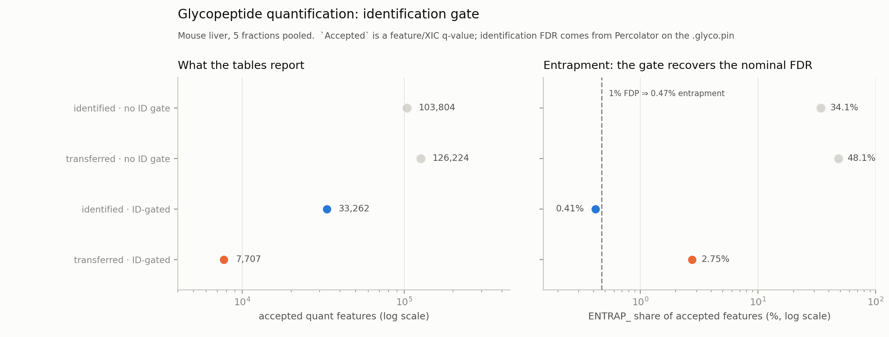
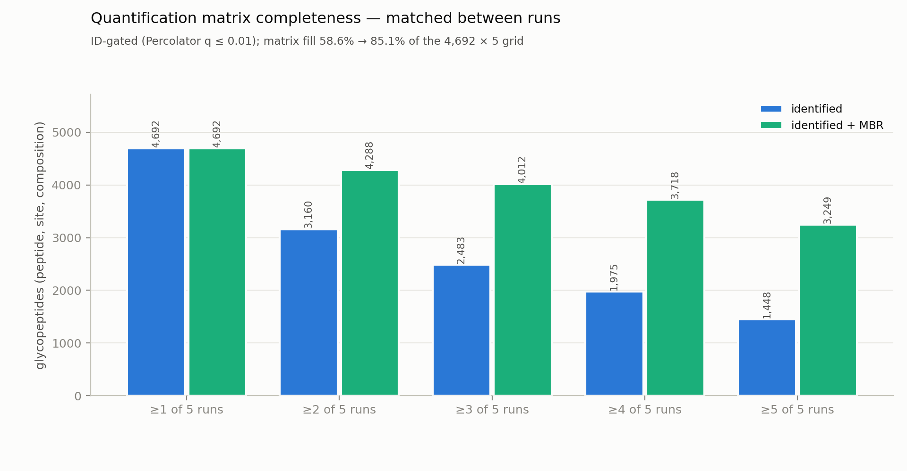
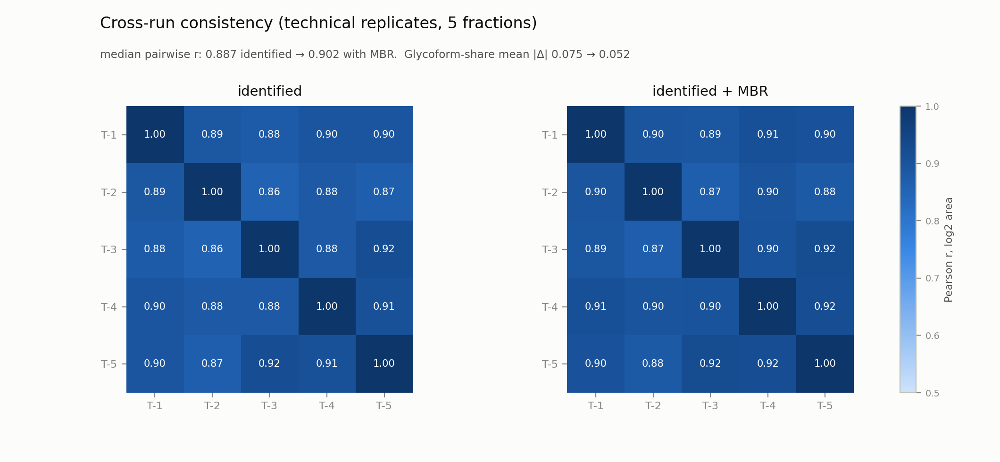

# Glycopeptide LFQ + match-between-runs benchmark — mouse liver, 5 fractions

This benchmark exercises the intact-glycopeptide quantification path
(`andes --glyco --lfq --mbr`) on the five mouse-liver HCD fractions of
PXD005553 (deep tier: all fractions searched together, one pooled PIN). It
answers two questions:

1. **Identification** — does the search still produce a controlled set of
   glycopeptides on this data? (the existing harness already checks this; repeated
   here so the quantification has a fixed denominator)
2. **Quantification** — once identification is controlled, do the LFQ areas and
   the MBR transfers behave like measurements: complete matrices, consistent
   replicates, stable glycoform shares, stable protein roll-ups?

No external quantitative reference exists for these files: the pGlyco2 and
MSFragger-Glyco tables in `../truth/` carry no intensities, and the published
intact-glycopeptide LFQ method (Zeng et al. 2022) requires a third-party search
engine's result files that are not available here. Quantitative quality
is therefore assessed by internal consistency, not by agreement with another
engine's areas.

## Result in brief

| | value |
|---|---|
| glyco-PSMs at 1% FDR (pooled Percolator) | **33,823** |
| unique glycopeptides at 1% (topology-resolved) | **6,509** |
| entrapment FDP at 1% (sequon-corrected) | **0.93%** (95% CI 0.79–1.10) |
| of those PSMs quantified by `--lfq` | **98.3%** (33,262 of 33,823) |
| ID-gated quantified features (identified + transferred) | **40,969** (33,262 + 7,707) |
| glycopeptides at composition / topology resolution | **4,692 / 6,436** |
| matrix fill, identified-only → +MBR | **58.6% → 85.1%** |
| glycopeptides in ≥3 runs, identified → +MBR | **2,483 → 4,012** |
| cross-run Pearson (log2 area), identified → +MBR | **0.887 → 0.902** |
| glycoform-share mean \|Δ\|, identified → +MBR | **0.075 → 0.052** |
| protein Top3 cross-run r, identified → +MBR | **0.936 → 0.964** |

The `--glyco --mbr` transfer now uses a trained MLP match scorer (§6).
Against the previous cosine-gated transfer on the same PIN, median replicate r
rises **0.845 → 0.902** and protein Top3 r **0.926 → 0.964**, with the same
identification set and the same transfer FDP (1.83% → 1.82%); the gain is
confined to transferred measurements (one-transferred r 0.630 → 0.816).

**The most important result is a measurement-semantics one.** The `Accepted`
flag in the emitted tables is a *feature/measurement* q-value (XIC target vs its
+11 Th decoy twin), not an identification FDR. Used as shipped, the tables
report 230,028 quantified features whose entrapment share is **41.8%**
(sequon-corrected FDP ≈ **89.0%**). Joining each feature to the Percolator
q-value of its PSM (the `.lfq.tsv` `SpecId` matches the PIN byte for byte; a
transferred row carries `{donor SpecId}_mbr_{run}`) leaves 40,969 features
(17.8%) with a 0.85% entrapment share (FDP 1.82%; 0.88% for identified
features alone). Every quantification number below is computed **after** that
join. This is the documented workflow, but the emitted `Accepted` column alone
is easy to misread, and the gap between the two readings is large enough to
dominate any conclusion drawn from the tables.

## Data and search parameters

| | |
|---|---|
| spectra | `MouseLiver-Z-T-1.raw` … `MouseLiver-Z-T-5.raw` (PXD005553, HCD, Q Exactive) |
| database | `mouse_entrap.fasta`: 17,229 mouse + 17,229 same-length shuffled `ENTRAP_` proteins |
| decoys | `--decoy-strategy sequon` (shuffle, then restore the target sequon count; this replaced the older `sequon-reverse` name and recipe upstream) |
| glycan DB | `pGlyco-N-Mouse.gdb`, 6,660 entries with structure (topology) preserved |
| search | trypsin, ≤3 missed cleavages, 6–50 aa, 20 ppm, charge 2–5, oxidation M |
| quant | MS1, 10 ppm, ±120 s (the glycopeptide default), ≥4 isotopes, cosine ≥ 0.7, feature FDR 0.05 |
| MBR matcher | 10 → 64 → 32 → 8 → 2 MLP (published match model), shipped in `resources/quant/glyco_mbr_model.txt`; search ±3σ clamped to 60–120 s |
| runtime | ≈14 min end-to-end (PIN phase 796 s); 112 threads; candidate index cached |
| andes | 0.4.0, the commit that adds the MBR match scorer on `origin/main` `0f036477`; its PIN is byte-identical (md5 `db764f34dd037ef9e0f1dc2e20fd63e7`) to the run on the `e52bb3a` search baseline |

Outputs are written next to the PIN. Because `--output-pin` was given a name
already ending in `.glyco.pin`, andes appends its own suffix, so the files are
`mouseliver5.glyco.glyco.lfq.tsv`, `…glyco.pin`, and so on.

## 1. Identification layer (context)

Pooled Percolator 3.7.1 (`--seed 42 -Y --only-psms=false`) on the 211,392-row
PIN:

| gate | target PSMs | entrapment hits | sequon-corrected FDP |
|---|---:|---:|---:|
| q ≤ 0.01 | 33,823 | 148 | **0.93%** |
| q ≤ 0.05 | 35,747 | 690 | 4.11% |

The search-space correction is 2.13× (sample 50,425 N-X-S/T sequons vs
entrapment 44,593). Agreement with the two reference engines on the same
spectra:

| reference | spectra | recovered at andes 1% |
|---|---:|---:|
| pGlyco2 (depositors') | 17,855 | **89.1%** (15,912) |
| MSFragger-Glyco | 14,626 | **89.9%** (13,152) |

`eval_yield.py`: 33,823 glyco-PSMs, 6,509 unique glycopeptides, 2,306
compositions, 1,223 glycosites.

## 2. What the quantification tables contain

`Accepted` = feature q ≤ 0.05. Per run, before any identification gate:

| run | identified rows | transferred rows | accepted identified | accepted transferred |
|---|---:|---:|---:|---:|
| T-1 | 23,839 | 46,608 | 21,519 | 24,569 |
| T-2 | 21,801 | 48,369 | 19,624 | 24,855 |
| T-3 | 23,115 | 46,960 | 20,835 | 25,832 |
| T-4 | 23,293 | 47,079 | 20,796 | 25,420 |
| T-5 | 23,581 | 46,776 | 21,030 | 25,548 |
| **all** | **115,629** | **235,792** | **103,804** | **126,224** |

That is 230,028 accepted features over 61,724 (peptide, site, composition)
glycopeptides. The emitted tables agree with each other: `.glyco.matrix.tsv` has
61,724 rows and 201,038 filled cells, exactly the rows of `.glyco.quant.tsv`;
`site.tsv` glycoform shares sum to 1.0 within 1e-5 per (run, peptide, site) at
every one of 120,257 glycoform-site spectra; and no protein has Top3 > summed
area.

Their entrapment share and the effect of the identification gate:



| feature set | features | entrapment | sequon-corrected FDP |
|---|---:|---:|---:|
| accepted, no ID gate | 230,028 | 41.8% | 89.0% |
| accepted + ID q ≤ 0.01 | 40,969 | 0.85% | 1.82% |
| accepted + ID q > 0.05 / no q | 184,826 | 51.0% | 108.7% |

By evidence class, at the 1% gate: identified 138/33,262 entrap (0.41%),
transferred 212/7,707 (2.75%). Transfers are discussed in §6.

Gated feature counts per run (identified + transferred): 8,399 / 8,114 / 8,223 /
8,049 / 8,184 — flat across fractions, as replicates should be. Quantification
recovers 33,262 of the 33,823 accepted PSMs (98.3%); the remaining 1.7% did not
produce an accepted feature (XIC cosine/envelope gates or no usable MS1 scan).

## 3. Matrix completeness

4,692 glycopeptides × 5 runs. Without MBR, 13,758 cells are filled (58.6%);
MBR fills 6,201 more, for 19,959 (85.1%). The number of *identified*
glycopeptides does not change (4,692); MBR only adds measurements of existing
identifications.



| presence | identified | identified + MBR |
|---|---:|---:|
| ≥1 run | 4,692 | 4,692 |
| ≥2 runs | 3,160 | 4,288 |
| ≥3 runs | 2,483 | 4,012 |
| ≥4 runs | 1,975 | 3,718 |
| ≥5 runs | 1,448 | 3,249 |

## 4. Cross-run consistency

Pearson r on log2 area, pairwise over glycopeptides measured in both runs:

| | identified | identified + MBR |
|---|---:|---:|
| median pairwise r | **0.887** | **0.902** |
| range | 0.856–0.918 | 0.869–0.925 |



With the match scorer, MBR no longer trades consistency for coverage: the added
cells are measured at the window the scorer chose, so the median pairwise r
rises rather than falls. Splitting each pair by how the two measurements were
obtained:

| class | median r | range | n per pair |
|---|---:|---|---:|
| both identified | **0.899** | 0.869–0.926 | 1,850–2,121 |
| one transferred | **0.816** | 0.737–0.861 | 935–1,130 |
| both transferred | **0.886** | 0.838–0.900 | 489–749 |

Glycoform shares agree better after MBR, because MBR adds the missing glycoforms
of a site in runs that identified only part of the family: mean |Δshare| 0.0754
→ **0.0516** (19,843 → 36,462 site-glycan pairs).

## 5. Protein roll-up

659 protein groups have at least one ID-gated glycopeptide. Summed glycopeptide
area vs Top3 (three most intense glycopeptides) is internally consistent, and
Top3 reproduces across runs:

- median cross-run Top3 Pearson r: **0.936** (identified) → **0.964** (+MBR).

Only 659 proteins is expected at this FDR with the 17,229-protein mouse
database; the ungated tables inflate this to 13,552, another symptom of
quantifying unfiltered rank-1 matches.

## 6. Transfers and their quality

`--glyco --mbr` now uses a trained cross-run match scorer (`glyco_match`); the
previous version trusted the RT-map prediction and gated a single extraction
around it by the isotope-envelope cosine. The scorer instead:

1. builds a reference from the donor run's isotope XIC for the identified
   feature, on a 1 s RT grid;
2. slides that reference across the target run around the RT-map prediction
   (±3σ, clamped to 60–120 s) and extracts the ten match features at every
   shift;
3. ranks shifts by the small-window plus extraction-window cosine, keeps the
   top 10 non-maximum-suppressed candidates, and runs the MLP
   (10 → 64 → 32 → 8 → 2);
4. takes `0.85 · p + 0.15 · cosine` as the match score, where `p` is the
   softmax of the class-1 logits over those ten candidates, and quantifies the
   chosen candidate's peak window.

The +11 Th decoy twin gets the same treatment with its own reference and its
own chosen window, so the transfer q remains a symmetric target/decoy
competition. The weights ship in `resources/quant/glyco_mbr_model.txt`; they
were trained by `scripts/train_glyco_mbr.py` on the table this benchmark writes
with `--glyco-mbr-match-train` (§9). Training used the five liver fractions:
peptide-disjoint validation ROC AUC **0.9634** (10% of peptides held out).

Run on the same PIN, the scorer changes only the transfer layer:

| | previous cosine gate | trained matcher |
|---|---:|---:|
| transfers measured | 180,218 | **224,904** |
| accepted at feature q ≤ 0.05 | 145,347 | **126,224** |
| accepted and donor ID q ≤ 0.01 | 7,177 | **7,707** |
| ID-gated features | 40,439 | **40,969** |
| matrix fill | 83.6% | **85.1%** |
| median replicate r | 0.845 | **0.902** |
| one-transferred r | 0.630 | **0.816** |
| both-transferred r | 0.662 | **0.886** |
| protein Top3 r | 0.926 | **0.964** |
| transfer entrapment (ID-gated) | 2.93% | 2.75% |
| sequon-corrected FDP | 1.83% | 1.82% |

Fewer transfers pass the raw feature q (126,224 vs 145,347), but more of the
ones that are real do (7,707 vs 7,177): the scorer rejects decoy-like windows
rather than accepting them at the same rate. Identifications are byte-identical
(the PINs hash the same), so the gain is not from the search.

The overlap with the training data makes the full-set numbers optimistic; the
peptide-disjoint 10% (never used to train the shipped weights) reproduces the
effect:

| held-out 10% of peptides | previous | matcher |
|---|---:|---:|
| gated transfers | 681 | **703** |
| matrix fill | 83.7% | **84.7%** |
| median replicate r | 0.832 | **0.882** |
| one-transferred r | 0.598 | **0.757** |
| both-transferred r | 0.618 | **0.824** |
| protein Top3 r | 0.903 | **0.951** |

- Transfer feature q (accepted): median 0.0259, p90 0.0313, max 0.0399 — the
  transfer competition uses its own target/decoy class, as designed.
- 7,707 gated transfers come from **3,218 distinct donor PSMs** (mean 2.4 target
  runs per donor). The donor subset is still enriched in entrapment (2.14% of
  donor PSMs vs 0.41% of identified features), and false rank-1 matches are
  enriched among abundant features; the source q-value alone therefore does not
  make an MBR-only cell as trustworthy as a directly identified one. MBR remains
  a coverage tool: the transfer q separates the classes, and downstream analysis
  should keep them distinguishable.

## 7. Glycan topology

The glycan database retains 6,660 tree topologies. Quantification is inherently
composition-level (two topologies of one composition are one intact precursor
mass), while the search, scoring and output keep the tree:

| | compositions | topologies | compositions with >1 topology |
|---|---:|---:|---:|
| all accepted (no gate) | 61,724 | 65,036 | 2,465 |
| ID-gated | 4,692 | 6,436 | 1,141 |

At the identification gate, **24% of quantified compositions (1,141/4,692)
retain more than one topology** — the isomer ambiguity is carried through to the
output rather than collapsed away, which is the point of the topology-retention
change. `eval_yield.py` counts 6,509 topology-resolved glycopeptides at 1%;
6,436 survive quantification. The two counters key the peptide slightly
differently (the PIN counter folds modified residues and reads the full tag), so
read this as agreement in scale, not an exact identity.

## 8. Limitations

- **No external quantitative reference.** Every quantitative claim here is
  internal (replicate consistency, completeness, share stability). It shows the
  path is self-consistent, not that it matches the original method's areas.
- **Two q-value layers.** The emitted `Accepted` is a measurement q; the
  identification q must be joined from Percolator. The tables do not encode
  both. A future CLI pass that filters `.glyco.lfq.tsv` by an optional
  `--psms` argument would remove this trap; until then the join is mandatory.
- **Entrapment estimator is linear** (raw share × (1 + S/E)); at the extreme
  ungated values it extrapolates past 100%. It is accurate near the 1% gate,
  where it is used for the verdicts.
- **FQR is not implemented** (the original method's two-component GMM over the
  +10 Da decoy). The feature q here is a picked target/decoy q-value against the
  +11 Th twin, and the transfer q is a separate class.
- **MBR RT model** is piecewise-linear per run with one knot per 300 anchors
  (14,675 anchors over 5 maps). It is only the prior for the match search, which
  may move the reference up to 3σ (clamped to 60–120 s); the design target is
  replicate/fraction matching, not large RT shifts.
- **The match model is trained on this dataset.** The shipped weights were
  trained on labels from these five liver fractions (90% of peptides; the other
  10% gave the 0.9634 peptide-disjoint validation AUC). The held-out block in
  §6 is the honest estimate; the full-set numbers are partly in-sample. Retrain
  with `--glyco-mbr-match-train` and `scripts/train_glyco_mbr.py` when adding
  data from other tissues or instruments.
- **Numbers move with the search baseline.** This run is on the matcher commit
  rebased onto `origin/main` `0f036477`, with `--decoy-strategy sequon`; its PIN
  is byte-identical to the run on the `e52bb3a` search baseline, so the numbers
  above are unchanged between the two. An earlier version of this file was
  measured on the `glyco/topology-wurcs` tree with the retired `sequon-reverse`
  decoy recipe, which produces different decoy sequences. Compare runs within
  one baseline, not across decoy strategies.

## 9. Reproduction

The analysis scripts need `numpy`, `pandas`, `matplotlib` and `scipy`.

```bash
# 0. Thermo .raw input needs the `thermo` feature
cargo build --release -p andes --bin andes --features thermo

# 1. search + quantify (5 fractions -> one PIN + lfq/matrix tables)
DOTNET_ROOT=/home/daichengxin/.dotnet \
/home/daichengxin/gitrepo/andes/target/release/andes \
  --spectrum /Data/daicx/glyco-mouse/MouseLiver-Z-T-{1,2,3,4,5}.raw \
  --database /home/daichengxin/andes-bench/databases/mouse_entrap.fasta \
  --decoy-strategy sequon \
  --glyco --glyco-glycan-gdb /home/daichengxin/gitrepo/pro/pGlyco-N-Mouse.gdb \
  --fragmentation HCD --fragment-tol-ppm 20 \
  --lfq --mbr --threads 112 \
  --output-pin /tmp/glyco_quant_bench/mouseliver5.glyco.pin

# 2. pooled Percolator (OUT is the directory holding the PIN)
OUT=/tmp/glyco_quant_bench
docker run --rm -v "$OUT":/r quay.io/biocontainers/percolator:3.7.1--h3b5f4bd_2 \
  percolator --seed 42 -Y --only-psms=false \
  --results-psms /r/out.psms --decoy-results-psms /r/out.dpsms \
  /r/mouseliver5.glyco.glyco.pin

# 3. identification checks (run from $OUT; H = this directory)
H=/home/daichengxin/gitrepo/andes/docs/benchmarks/glyco
cd "$OUT"
python3 "$H/eval_yield.py"  mouseliver5.glyco.glyco.pin out.psms
python3 "$H/eval_entrap.py" mouseliver5.glyco.glyco.pin out.psms 0.01 \
  /home/daichengxin/andes-bench/databases/mouse_entrap.fasta
python3 "$H/score_vs_truth.py" "$H/truth/pglyco2_mouse_liver.tsv.gz" \
  mouseliver5.glyco.glyco.pin out.psms 0.01
python3 "$H/score_vs_truth.py" "$H/truth/msfragger_glyco_mouse_liver.tsv.gz" \
  mouseliver5.glyco.glyco.pin out.psms 0.01

# 4. quantification analysis + figures
python3 "$H/quant_mouse_liver/glyco_quant_bench.py" --dir "$OUT" \
  --stem mouseliver5.glyco --out "$OUT/report" \
  --psms "$OUT/out.psms" \
  --fasta /home/daichengxin/andes-bench/databases/mouse_entrap.fasta
python3 "$H/quant_mouse_liver/glyco_quant_figs.py" \
  --json "$OUT/report/glyco_quant_numbers.json" --out "$OUT/report"

# 5. retrain the MBR match scorer (optional; the shipped model is compiled in)
#    Re-run step 1 with --glyco-mbr-match-train "$OUT/match_train.tsv" added,
#    then train and rebuild:
python3 -I /home/daichengxin/gitrepo/andes/scripts/train_glyco_mbr.py \
  "$OUT/match_train.tsv" \
  --out /home/daichengxin/gitrepo/andes/resources/quant/glyco_mbr_model.txt \
  --epochs 100 --max-negatives 5 \
  --source "5 mouse-liver fractions, --decoy-strategy sequon"
cargo build --release -p andes --bin andes --features thermo   # include_str! refresh
```

## Files

| file | content |
|---|---|
| `run_glyco_quant_bench.sh` | the andes invocation used here |
| `glyco_quant_bench.py` | analysis: gate join, matrix, consistency, proteins, entrapment |
| `glyco_quant_figs.py` | the three figures |
| `glyco_quant_report.md` | full generated tables (every run pair, every evidence split) |
| `glyco_quant_numbers.json` | machine-readable results |
| `fig1_identification_gate.png` | what the tables report vs the identification gate |
| `fig2_matrix_completeness.png` | glycopeptides reaching ≥k runs, identified vs +MBR |
| `fig3_cross_run.png` | 5×5 Pearson log2-area heatmaps |
