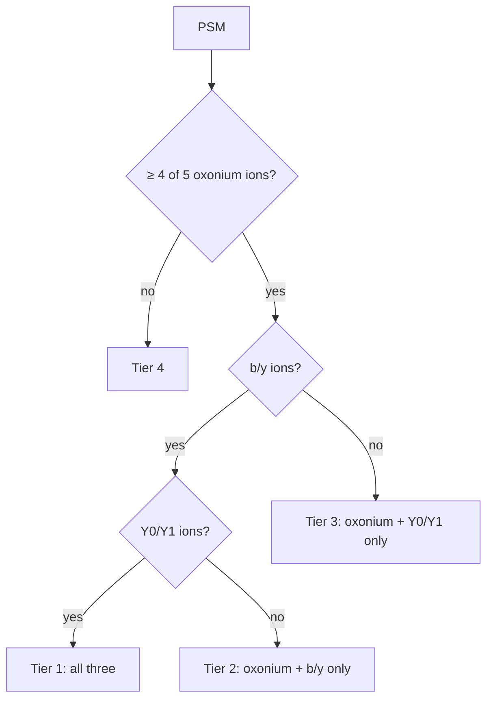

# Glycoproteomics benchmark: PXD065680

andes `--glyco` was run on the HCD F03 file of a published five-tool glycoproteomics comparison,
and its counts are placed beside that paper's per-tool counts. andes results carry an entrapment
error estimate; the paper's tools do not.

| | |
|---|---|
| Dataset | PXD065680 (jPOST JPST003908): BJAB-K20 membrane N-glycopeptides, Orbitrap Fusion, file F03 HCD |
| Paper | Sakaue *et al.*, *J Proteome Res* 2026, [doi 10.1021/acs.jproteome.6c00345](https://doi.org/10.1021/acs.jproteome.6c00345): Byonic, Glyco-Decipher, MSFragger-Glyco, pGlyco3 and GRable |
| andes | `main` at `24cec490`, Percolator 3.7.1, measured 2026-10-28 |
| Counted as | unique sequence + glycan composition, the closest rule to the paper's unit |

## Counts

!!! warning "Counts, not error rates"
    The ranking compares counts. The paper gives no independent error estimate for its tools, and
    Glyco-Decipher and GRable apply no FDR filter. Every andes arm has an entrapment FDP **at or
    above the 1% nominal** (1.04–1.50%), so the andes bars are not a like-for-like error level
    with the 1% PSM FDR rule that Byonic, MSFragger-Glyco and pGlyco3 apply. The andes and paper
    protocols also differ (see [Deviations](#deviations-from-the-papers-protocol)).

### The andes arms

| Arm | Unique | GlycoPSMs | Entrapment FDP | Settings |
|---|---:|---:|---:|---|
| A | 1,225 | 1,679 | 1.14% | UniProt reviewed human (20,410), up to 3 missed cleavages, length 6–50, glyco tolerance 20 ppm |
| **A2** | **1,174** | 1,616 | 1.18% (95% CI 0.43–2.57) | UniProt 2020_02 human (20,365), 2 missed cleavages, length 5–50, NeuAc list; closest to the paper's settings |
| N | 1,260 | 1,698 | 1.50% | as A2, NeuAc plus NeuGc list |
| B | 1,141 | 1,538 | 1.04% | as A, fragment tolerance 0.05 Da approximated as 100 ppm |

Percolator seed changes arm A between 1,225 and 1,234 identifications and between 1.14% and
1.89% FDP, so differences of a few dozen identifications against Byonic are inside that spread.

## Overlap with the published tools (arm A2)

Computed against the Table S1 copy in the jPOST deposit (union 1,761 glycopeptides), which may be
a preprint-era version; the final per-tool lists are larger, so these shares are lower bounds.

**1,072 of andes A2's 1,174** identifications are in the union of the five tools. The remaining 102
are reported by none of them; at the other end, 298 are reported by all five.

## Evidence tiers

The paper stratifies each PSM by glycan evidence (at least 4 of 5 HexNAc oxonium ions) and
peptide evidence (Y0/Y1 and b/y ions) at 0.05 Da on the unfiltered spectra:

andes gates candidates on oxonium evidence during the search, and 0.05 Da b/y matching is
permissive, so near-saturation in Tier 1 is expected. The tiers measure spectral support, not
correctness; the entrapment FDP is the correctness estimate.

## Rare sialic acids (NeuGc)

The paper's rare-sialic-acid search used a library with each NeuAc replaced by NeuGc or KDN.

| Source | NeuGc glycopeptides | Notes |
|---|---|---|
| andes arm N | 68 unique sequence + composition (77 glycoPSMs, 43 unique sequences) | 0 entrapment hits |
| Paper, Fig. 9A | Byonic 39, GRable 18, MSFragger-Glyco 8, pGlyco3 6 | counted as peptides; Glyco-Decipher found none |

22 of andes's 68 NeuGc identifications are in the paper's Table S2 (Byonic 21, GRable 8, pGlyco3 5,
MSFragger-Glyco 3). NeuGc glycan trees were made by relabelling NeuAc leaves of the bundled human
trees, so antenna placement is arbitrary. The **KDN arm was not run**: the andes glycan format has
no KDN symbol, mass or diagnostic ions.

## Deviations from the paper's protocol

- **FASTA:** UniProt release 2020_02 human (20,365 entries) stands in for SwissProt_Human_20200519,
  which was not obtained. Arms A and B used a different reviewed file (20,410 entries); the two
  share 20,301 accessions. Yeast Swiss-Prot entries are appended as entrapment targets.
- **Missed cleavages and length:** arms A and B used up to 3 and 6–50; arms A2 and N used 2 and
  5–50, as in the paper.
- **Peptide mass:** the paper uses 350–10,000 Da; andes has no flag for it, so no limit was applied.
- **Enzyme:** trypsin only; the paper used LysC plus trypsin.
- **Error control:** Percolator at 1% for andes, against each paper tool's own rule.
- **Glycan trees:** the composition set matches the paper's, but andes needs trees, so bundled
  isomer trees were used (1,017 topologies for NeuAc, 1,862 for NeuAc plus NeuGc).
- **Other settings:** single file (no pooling before Percolator), precursor tolerance 7 ppm, fixed
  carbamidomethyl (C), variable oxidation (M), pyroGlu (N-terminal Q) and ammonia loss (N-terminal C).
- **Counting rule:** no rule tested on the deposit's Table S1 reproduces the paper's counts;
  sequence + composition is the closest (1,200 / 1,070 / 871 / 858 / 717 against the paper's
  1,244 / 1,072 / 1,000 / 861 / 717). The final Table S1–S5 spreadsheets are needed to settle it.
- **Training data:** PXD065680 does not appear in any recorded andes training source; the source
  ledger was not audited exhaustively.

More glyco results (PXD005553 mouse liver, against pGlyco2 and MSFragger-Glyco) are in the
[full benchmark report](details.md#1-summary). How to run it: [intact N-glycopeptide search](../modes.md#intact-n-glycopeptide-search---glyco-experimental).
