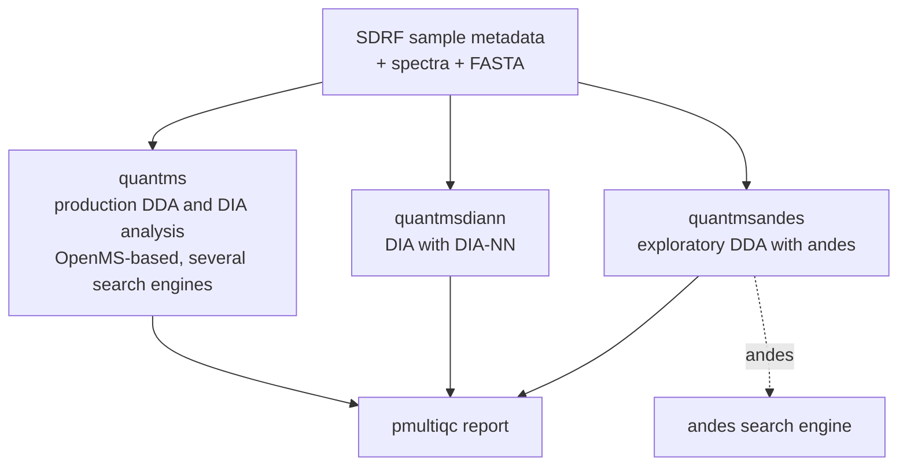
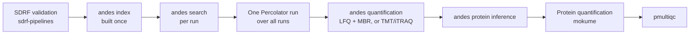

# The quantms ecosystem

andes is the search engine behind **quantmsandes**, one of three independent pipelines in the
quantms ecosystem. They share sample metadata ([SDRF](https://github.com/bigbio/proteomics-metadata-standard))
and quality control ([pmultiqc](https://github.com/bigbio/pmultiqc)); the use case decides which
to run.

| Pipeline | Use it for | Engine |
|---|---|---|
| [quantms](https://github.com/bigbio/quantms) | **Production** analysis of DDA label-free, TMT/iTRAQ and DIA data | OpenMS-based workflow, several search engines |
| [quantmsdiann](https://github.com/bigbio/quantmsdiann) | DIA analysis | DIA-NN |
| [quantmsandes](https://github.com/bigbio/quantmsandes) | **Exploratory** DDA analysis: new algorithms, glycoproteomics, proteoforms, agentic analysis | andes |

!!! warning "Production versus exploratory"
    quantms is the production pipeline. quantmsandes is for trying new methods, so its defaults,
    parameters and outputs may change between releases. For routine analyses, use quantms.

## What quantmsandes is for

- **New algorithms** in identification and quantification: andes's scoring models, chimeric
  search, PTM refinement and match between runs, as in [Distinctive features](features/index.md).
- **Glycoproteomics:** intact N-glycopeptide search against species-specific glycan databases.
- **Proteoforms:** variants, isoforms, mature chains and annotated sites, with knockoff-based error
  estimates and a per-protein-family proteoform table with quantities.
- **Agentic analysis:** andes exposes many advanced parameters, and quantmsandes passes them
  through so an AI agent can choose and tune them for a dataset and question, and compare outcomes.

## Planned workflow

Percolator rescoring runs once over all runs, on andes's features plus predicted retention-time and
fragment features that andes computes during the search.

!!! info "Status"
    quantmsandes is in early development: the repository holds the pipeline template and the
    [design](https://github.com/bigbio/quantmsandes/blob/dev/docs/design.md), and the workflow
    is not runnable yet. Until it is, run andes directly with the
    [quick start](getting-started/quickstart.md), or feed its QPX output to downstream tools.

## andes outputs

andes writes a Percolator-ready PIN and, on request, a QPX bundle (`--output-parquet`) that
downstream quantms-ecosystem tools read: PSMs, protein groups, features and quantification as
Parquet tables with versioned schemas. See [output formats](reference.md#3-output-formats).
