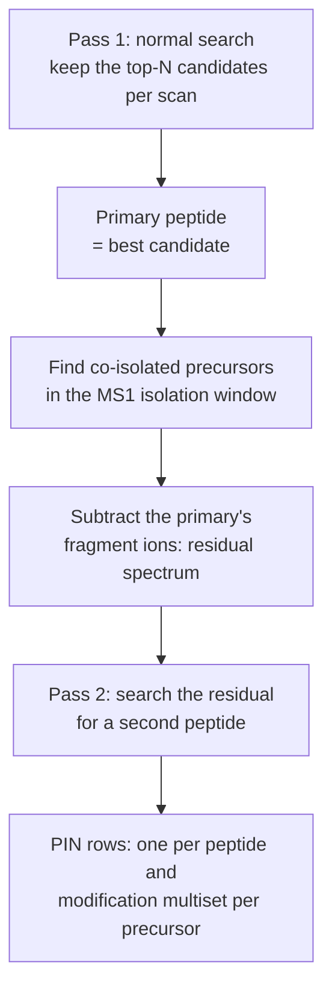

# Chimeric cascade

## The problem

A fragmentation spectrum is often a mixture: the isolation window lets in more than one peptide.
A search that reports one peptide per spectrum leaves the second one unexplained, and its
fragments become noise for the first.

## How it works



Keeping the pass-1 *alternatives* rather than only the best candidate is what made the second
pass pay off.

## What it changes

Astral (PXD070049), at an entrapment-estimated **true FDP of 1%**, Percolator seeds 42, 1 and 2:


Distinct peptides rise by a smaller factor (29,384–29,400 against 26,723–26,746), so most of the
extra PSMs are second peptides of spectra whose first peptide was already known: the gain is
mainly **depth**, with some new coverage. The comparison is made at an equal *true* FDP of 1%,
because `--chimeric` rows carry a slightly higher true FDP at the same nominal q-value. On UPS1,
PSMs at q ≤ 0.01 rose 8.0% with entrapment hits flat. Measured on earlier builds
(2026-10-05 to 2026-10-13); the [benchmark report](../benchmarks/details.md#1-summary) has the
conditions.

Needs mzML or Thermo `.raw`; timsTOF `.d` falls back to a normal search.

```bash
andes --spectrum sample.raw --database proteins.fasta --chimeric --rescore --output-pin out.pin
```
