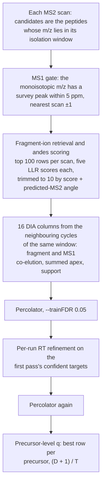

# DIA search

## The problem

A data-independent acquisition (DIA) scan fragments everything in a fixed m/z window, so there is
no selected precursor and every spectrum is a mixture. A DDA search assumes one precursor per scan
and fails here. Peptide-centric DIA engines (OpenSWATH, DIA-NN) start from a spectral library and
look for each precursor's fragment chromatograms instead.

## How it works

`--dia` keeps andes's spectrum search and adds the chromatography as rescoring evidence:



- **Window search.** A scan accepts every peptide (at every `--charge`) whose precursor m/z lies
  in its isolation window, widened by `--precursor-tol`. The PSM's precursor m/z is the peptide's
  own, so target-decoy competition groups a scan's rows by mass.
- **MS1 gate.** A candidate is scored only when its monoisotopic m/z has a survey peak. On the
  benchmark it keeps the MS1 peak of 93% of DIA-NN's precursors and of 13% of random candidates,
  and cuts search time by a quarter to two fifths.
- **Co-elution columns.** The scan's most intense matched fragments are traced over ±5 cycles of
  the same window, together with the precursor's MS1 trace and isotope pattern; the summed-apex
  columns count fragments present in at least two of three adjacent cycles, which is what
  separates weak true precursors that span only 1–3 scans.
- **Re-ranking.** With `--predict ms2` the search keeps 100 rows per scan, and after prediction each
  scan keeps its `--top-n` (10) rows by z-scored RawScore plus z-scored andes-ms2 spectral angle.
  In 45% of the scans where a true precursor ranked below first, the winner was a decoy, and the
  true peptide's predicted-MS2 angle was usually higher.
- **Pool scores.** Before that cut, each of the 100 rows gets five scores from its predicted b/y
  ions: a likelihood ratio of their presence in the scan against chance (learned per run from the
  confident rows and the decoy rows, each on half of the peptidoforms and applied to the other
  half), a same-apex term over the neighbouring cycles, and three variants that explain peaks away
  between the rows of one scan. They are Percolator features (`dia_llr`, `dia_apex_llr`,
  `dia_llr_greedy`, `dia_llr_soft`, `dia_angle_soft`).
- **Summed-spectrum and elution-profile columns.** With `--predict ms2`, each row also gets the
  predicted-MS2 angle of the apex±1 summed spectrum and of its top 8 predicted fragments projected
  on their median elution profile, plus how well those fragments follow that profile. Weak
  precursors lose most to interfered fragments; these columns score the ones that co-elute.
- **Rescoring.** A DIA PIN has about ten rows per scan and few PSMs at 1%, so Percolator trains at
  `--trainFDR 0.05`. A gradient-boosted model of each run's predicted-RT residual, fitted out of
  fold on the first pass's targets at q ≤ 1%, adds `dia_rt_refined_err`, and Percolator runs again.
- **Precursor-level q-values.** A precursor (run, peptidoform, charge) has several PSM rows across
  the scans of its elution, so Percolator's PSM-level q undercounts errors per precursor. After
  rescoring, each precursor is scored by its best row and target-decoy competition gives
  q = (D + 1) / T over precursors. Every reported row carries the q of that threshold at its own
  score, so keeping rows at q ≤ 0.01 keeps the precursors whose best row passes, at 1%
  precursor FDR.
- **Fragment tolerance.** On Orbitrap Astral, 7 ppm unless `--fragment-tol-*` is set: the per-run
  fragment-error measurement needs 100 confident PSMs, which a DIA sample rarely has.

No spectral library is needed. A single run with `--predict rt,ms2 --rescore` goes on from here
with the steps below.

## Pass 2, learned score and study mode

- **Pass 2.** Each precursor nominated by its best scan is traced over 73 cycles around its
  predicted RT, and its top predicted fragments are scored per cycle against per-run chance rates.
  A joint model of the traces adds likelihood columns.
- **Learned score.** A precursor PIN beside the pass-1 PIN has one row per nominated precursor,
  with a cross-fitted gradient-boosted score as a feature. Percolator rescores it, so its q is the
  precursor-level q. Its results are used only when they reach at least as many precursors at
  q 0.01 as pass 1; otherwise the pass-1 results are kept.
- **RT-aware candidate cut.** The per-scan cut of 100 candidates also ranks by agreement with the
  run's predicted RT. It falls back to votes when the RT prediction is poor.
- **Study mode.** For two or more runs of one experiment, each run adds evidence from the others:
  cross-run columns, and candidates that another run nominated and this one did not (transfer).
  The reported q is then class-wise: one competition for a run's own precursors and one for its
  transferred precursors, so a filter at q 0.01 holds for each.

```bash
andes --spectrum a.mzML --database db.fasta --dia --predict rt,ms2 --rescore \
      --output-pin a.pin --quant-dir q/          # once per run
andes quant extract  --quant-dir q/ --run a      # once per run, after all searches
andes quant finalize --quant-dir q/ -o experiment --database db.fasta
```

Finalize writes a precursor PIN and results per run, the protein groups of all runs, and the
per-run precursor quantities (`<base>.dia_quant.parquet`): a fragment quantity (the default) and an
MS1 quantity for every precursor at q ≤ 0.01, with a per-run median-level normalised column. Cost per
Astral run: about 20 min and 36 GB for the search, 9 min for the extract, and about 65 min for
finalize over three runs.

On three replicate Astral injections (full ProteoBench entrapment FASTA), the whole stack reaches
84,300 to 85,300 precursors per run at a true FDP of 1 %, against 57,000 to 58,000 for the build before this work. DIA-NN 2.3.2 reports about 85,100 per run at its own q 0.01, and at a matched true
FDP andes is at least 4 to 5 % behind it. Limits: replicate runs only, diaPASEF untested with
pass 2, and one transferred class measured 1.28 % true FDP at q 0.01. Details:
[benchmark](../benchmarks/dia.md) and the
[full reference](../reference.md#dia-pass-2-learned-score-and-study-mode).

On the ProteoBench DIA Astral quantification module (six runs, human/yeast/E. coli), andes
quantifies 115,200 precursors in at least 3 runs, against 103,700 for DIA-NN 2.5.0's public entry.
Its fold changes are less accurate: median |ε| 0.270 against 0.207, with E. coli and yeast ratios
compressed toward 0. Its CV is 0.164 against 0.150.

## What it changes

On the ProteoBench Astral entrapment set (two 15-min, 50 ng runs, 300 windows of 2 Th), andes
reaches 93% / 89% of DIA-NN's precursors at an entrapment true FDP of 1%, ahead of OpenDIA. See
the [DIA benchmark](../benchmarks/dia.md).

```bash
andes --spectrum run.mzML --database proteins.fasta --dia --predict rt,ms2 --rescore \
  --output-pin run.pin
```

The DIA PIN columns are listed in the [full reference](../reference.md#dia---dia-experimental).
