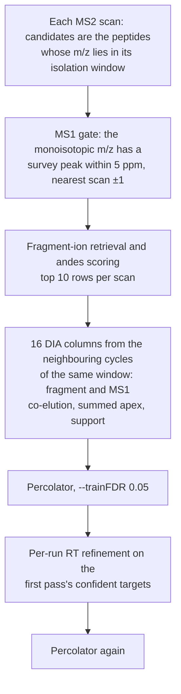

# DIA search

## The problem

A data-independent acquisition (DIA) scan fragments everything in a fixed m/z window, so there is
no selected precursor and every spectrum is a mixture. A DDA search assumes one precursor per scan
and fails here. Peptide-centric DIA engines (OpenSWATH, DIA-NN) start from a spectral library and
look for each precursor's fragment chromatograms instead.

## How it works

`--dia` keeps andes's spectrum search and adds the chromatography as rescoring evidence:



- **Window search.** A scan accepts every peptide (at every `--charge`) whose precursor m/z lies
  in its isolation window, widened by `--precursor-tol`. The PSM's precursor m/z is the peptide's
  own, so target-decoy competition groups a scan's rows by mass.
- **MS1 gate.** A candidate is scored only when its monoisotopic m/z has a survey peak. On the
  benchmark it keeps the MS1 peak of 93% of DIA-NN's precursors and of 13% of random candidates,
  and cuts search time by a quarter to two fifths.
- **Co-elution columns.** The scan's most intense matched fragments are traced over ±5 cycles of
  the same window, together with the precursor's MS1 trace and isotope pattern; the summed-apex
  columns count fragments present in at least two of three adjacent cycles, which is what
  separates weak true precursors that span only 1–3 scans.
- **Rescoring.** A DIA PIN has about ten rows per scan and few PSMs at 1%, so Percolator trains at
  `--trainFDR 0.05`. A gradient-boosted model of each run's predicted-RT residual, fitted out of
  fold on the first pass's targets at q ≤ 1%, adds `dia_rt_refined_err`, and Percolator runs again.
- **Fragment tolerance.** On Orbitrap Astral, 7 ppm unless `--fragment-tol-*` is set: the per-run
  fragment-error measurement needs 100 confident PSMs, which a DIA sample rarely has.

No spectral library is needed, and the output is a PSM-level PIN; quantification of DIA runs is
not implemented.

## What it changes

On the ProteoBench Astral entrapment set (two 15-min, 50 ng runs, 300 windows of 2 Th), andes
reaches 86% / 78% of DIA-NN's precursors at an entrapment true FDP of 1%, ahead of OpenDIA. See
the [DIA benchmark](../benchmarks/dia.md).

```bash
andes --spectrum run.mzML --database proteins.fasta --dia --predict rt,ms2 --rescore \
  --output-pin run.pin
```

The DIA PIN columns are listed in the [full reference](../reference.md#dia---dia-experimental).
