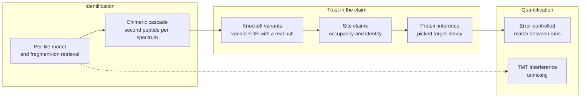

# Distinctive features

These are the parts of andes that were built to answer a specific question about trust in a
result, not just to find more peptides. Each page gives the problem, how andes addresses it,
a diagram, and measured numbers with their conditions.

!!! note "On wording"
    We describe what andes does and measure it. We have not surveyed every search engine, so
    these pages do not claim that nothing else does something similar; where the benchmark
    compares with another tool, it is named and dated.

| Feature | Question it answers | Flag |
|---|---|---|
| [Knockoff variant FDR](knockoffs.md) | Is this variant real, or a modification or isotope error that looks like one? | `--knockoffs`, `--proteoform-fdr` |
| [Site claims and identity](sites.md) | Is this residue modified, and which modification is it? | `sites=annotated` mods |
| [Chimeric cascade](chimeric.md) | What is the second peptide in this spectrum? | `--chimeric` |
| [Retrieval and model choice](retrieval.md) | How do you search deeply without scoring every candidate? | automatic |
| [Protein inference](proteins.md) | Which proteins are present, at what error rate? | `--protein-fdr` |
| [Match between runs with error control](mbr.md) | Can a transferred quantity be trusted? | `--lfq --mbr` |
| [TMT interference unmixing](tmt-unmix.md) | How much of a reporter ion is not from the identified peptide? | `--tmt-unmix` |
