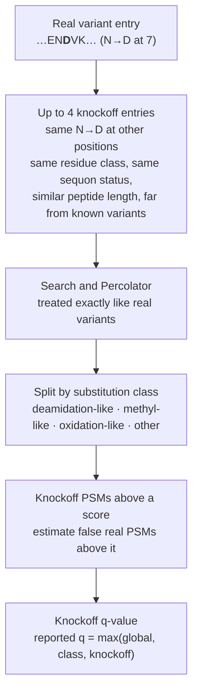

# Knockoff variant FDR

## The problem

A PSM on a UniProt variant entry claims that the sample carries that variant. Most false claims
are not random matches. They are an ordinary peptide that a common modification or an isotope
error makes look like the variant:

| Looks like a variant | Actually |
|---|---|
| N→D, Q→E | deamidation |
| G→A, D→E | methylation |
| a +1 Da substitution | a one-isotope mis-pick on the canonical peptide |

Decoys model random matches only, so a decoy-based q-value never sees this error.

## The idea

Give every variant claim a null that **makes the same mistakes**: a *knockoff* — the same
substitution placed at another position of the same protein that holds the same residue, with
matching context. A knockoff is almost certainly absent from the sample, but a modification or
isotope error that mimics the real substitution mimics the knockoff just as well.



A variant with no valid knockoff position has no null, so it is **not accepted**: measured against
genotypes, such variants are false several times more often than tested ones.

## What it changes

Checked against donor genotypes (PXD022787: four donors, one TMT10 set, 69 runs, ion-trap MS2).
A variant PSM is false when no donor haplotype carries its variant.


| Setting | Variant PSMs reported | True FDP |
|---|---:|---:|
| No knockoffs, class q ≤ 0.01 | 2,452 | 65% |
| No knockoffs, class q ≤ 0.05 | 3,886 | 71% |
| Knockoffs, `--proteoform-fdr 0.05` | 201 | **2.5%** |
| Knockoffs, `--proteoform-fdr 0.10` | 307 | **6.0%** |

Only 0.55% of knockoffs turned out to be a real donor variant, so the null is clean. The price
on everything else is small: PSMs at q ≤ 0.01 change by −0.43% on pooled Astral DDA and −0.30% on
the TMT set, and search time is unchanged.

### Prior tiers

Variant claims can come from several sources (`sample`, `common`, `curated`, `catalogue`).
Splitting the estimate by tier stops a sample's own variants and catalogue variants from sharing
one error estimate:


## Limits

- About 30% of single-residue variants can be given a knockoff, so most variants are not reported.
- Multi-residue variants, indels and isoform-borne variants get no knockoffs.
- Calibrated on one genotyped dataset with low-resolution MS2; the deamidation- and
  oxidation-like classes rest on small counts.

## Use it

```bash
andes --spectrum run1.mzML --spectrum run2.mzML --database uniprot_sprot_human.xml.gz \
  --uniprot-variants --uniprot-evidence curated --rescore --output-pin variants.pin
```

Parameters: [`--knockoffs`, `--proteoform-fdr`, `--uniprot-evidence`](../reference.md#1a-workflow-parameters-grouped-by-experimental-design).
The full description is in [Optional modes](../modes.md#variant-calls-checked-against-knockoffs---knockoffs---proteoform-fdr).
