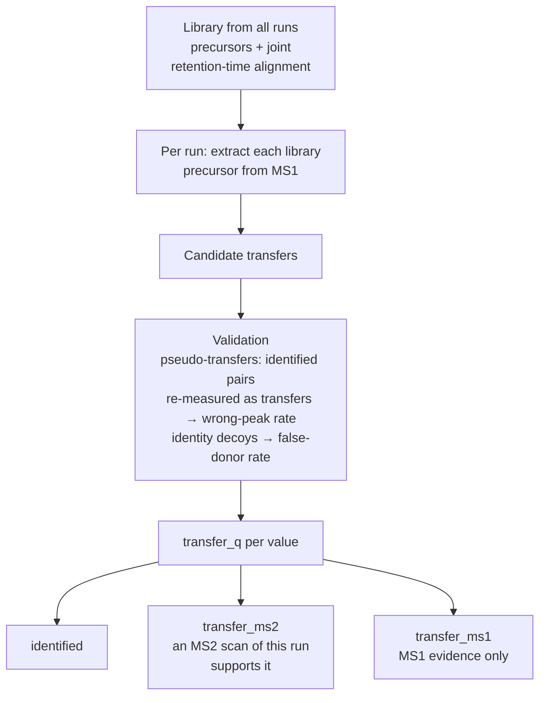

# Match between runs with error control

## The problem

Match between runs (MBR) fills in a peptide's quantity in a run where it was not identified, by
looking for it at the expected retention time. Filling gaps is easy; knowing which fills are
right is the hard part. A transfer can fail in two ways: it picks a **wrong peak**, or it
transfers from a donor identification that was itself **false**.

## How andes handles it

Every value in the output carries its evidence type and its own quality q-value.



- **`identified`**: the run has its own confident PSM.
- **`transfer_ms2`**: transferred, and an MS2 scan in this run supports it.
- **`transfer_ms1`**: any other accepted transfer.
- **`transfer_q`** / **`quant_q`**: an internal quant-quality q-value that counts both wrong
  peaks and false donors; it is not an identification FDR.
- A validation table (`<stem>.mbr_validation.parquet`) reports the pseudo-transfer acceptance and
  wrong-peak rates, so the error control is auditable.

## Measured

ProteoBench "Quant LFQ DDA ion QExactive" (PXD028735, 6 runs, human/yeast/*E. coli* mix), andes
defaults at transfer q 0.01: **65,012** precursors quantified in at least 3 runs, median |ε| 0.163,
CV 0.118, for 6.9k CPU-seconds in total. Raising `--mbr-fdr` to 0.05 gives a deeper, less accurate set: 71.2k precursors, median |ε| 0.176 and CV 0.132. The leaderboard comparison, with the other tools' versions and what they do
and do not control, is in the [benchmark report](../benchmarks/details.md#1-summary).

```bash
andes --spectrum run1.raw --spectrum run2.raw --database proteins.fasta \
  --lfq --mbr --rescore --output-parquet out.idparquet
```
