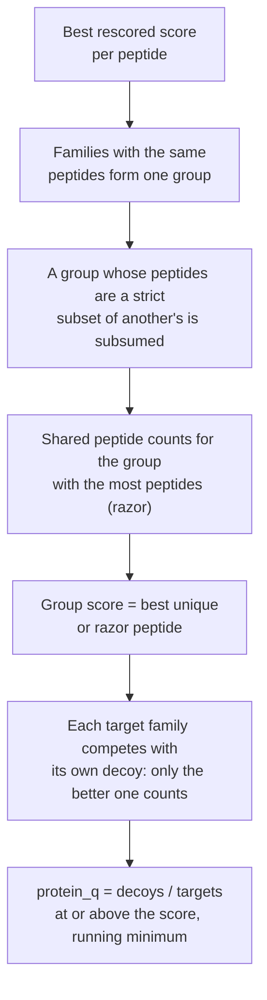

# Protein inference with picked target-decoy

andes infers proteins itself, with no external inference step, and gives each protein group a
q-value from **picked target-decoy competition**.

A *family* is the unit of evidence: with a FASTA each entry is its own family; with an annotation
database a family is a UniProt entry with its variants and isoforms, so alternative entries never
split a protein's evidence. A target that loses to its own decoy gets q = 1.

## Is the q-value honest?

Measured with entrapment databases: a group is false when every accession in it is an entrapment
entry.

Astral, three peptide-level shuffled entrapments: **0.7–1.1%** at protein q ≤ 0.01 and
**5.6–6.7%** at q ≤ 0.05 (dashed lines mark the nominal levels). UPS1 in yeast with an *E. coli*
entrapment reads 5.0% at 1%, led by proteins that co-purify with recombinant proteins expressed in
*E. coli* (EF-Tu, DnaK), so most of those are probably present and the shuffled design is the
better measure.

`andes inference` runs the same inference once over the PSMs of several runs. Output goes into the
QPX bundle and the filtered TSV (`protein_group`, `protein_q`).
