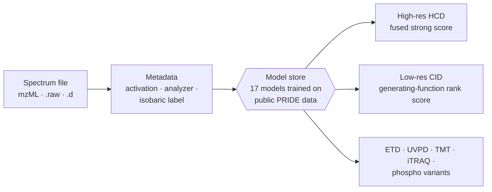
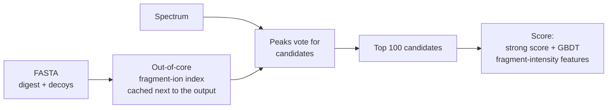

# Retrieval and model choice

## One model per file

andes reads the file's activation, resolution and isobaric label and picks one of 17 bundled
scoring models, with no flag needed. An uncovered regime uses the nearest model.

All models are trained on public PRIDE data and the store holds no model data derived from other
engines; the [model table](../models.md) lists the training data of each.

## Fragment-ion retrieval instead of scoring everything

The candidate index lives out-of-core, so candidates are retrieved by fragment ions that match
the spectrum. High-resolution searches score only the best 100 candidates; on low-resolution
data only the 150 most intense peaks vote.

- Phospho (PXD007653): 164 s instead of 99 minutes.
- Astral: +22% PSMs at an equal true FDP with the retrieval design.
- Glyco: only candidates carrying an N-X-S/T sequon are held in memory (3.2 of 28.0 million), so
  the run peaks at 4.5 GB with output identical to the earlier in-RAM path (20.0 GB).

The cost of a full run against another engine is on the [benchmarks page](../benchmarks/index.md#time-cpu-and-memory).
