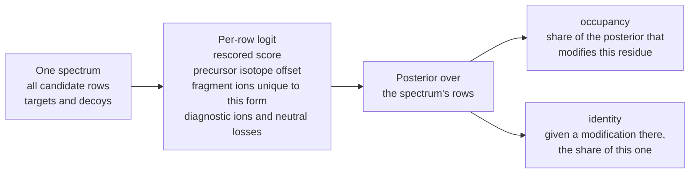

# Site claims and modification identity

## The problem

"This peptide is phosphorylated" and "this serine is phosphorylated" are different claims, and
"+42.047" can be acetylation or trimethylation. A site list needs an error estimate for the
*site*, and an honest answer to *which* modification.

## Knockoff sites

For annotated modification sites (UniProt, PEFF `\ModRes`), andes adds knockoff sites in the same
spirit as [knockoff variants](knockoffs.md): other residues of the same protein with the same
context. A PSM that puts the modification on an annotated site supports that claim; one that puts
it on a knockoff site is a false claim. Within each modification × residue × prior tier, the
knockoff PSMs estimate how many annotated-site claims are false, giving a **site q-value**.

## Occupancy and identity

Every accepted site gets two probabilities, computed over **all** rows of a spectrum so the
explanations compete with each other:

`identity_alternatives` lists the competing masses, for example `+42.0470:0.29` beside acetyl at
0.71. How much a diagnostic ion or neutral loss says is **learned from the run** rather than
fixed.

The output is `<stem>.sites.tsv`, one row per accepted site, with columns including `site_q`,
`confidence`, `occupancy`, `identity` and `identity_alternatives`.

## Where it works

Site claims are experimental and most useful with freely placed modifications. With phospho
restricted to annotated sites, many knockoff residues are really phosphorylated, so only 119
sites passed in the benchmark; the limits are in the
[full reference](../reference.md#site-claims-knockoff-sites-experimental).
