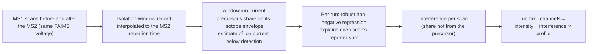

# TMT interference unmixing

## The problem

The reporter ions of a high-resolution MS2 scan come from **everything the quadrupole isolated**,
not just the identified peptide. Precursor purity from MS1 misses much of this, because a lot of
co-isolated ion current is below the MS1 detection limit. The result is ratio compression.

## How it works



No ground truth or reference channel is used; the coefficients come from the run itself. Original
channel columns are unchanged, and the unmixed values are added alongside.

`--tmt-unmix` takes `auto` (the default), `on` or `off`. `on` subtracts the whole estimate. `auto`
scales it by a strength between 0 and 1 learned per run: the value under which the interference-heavy
scans of a protein agree best with the same protein's clean scans, recorded in the `tmt.parquet`
metadata. `off` writes no interference columns. `auto` does nothing without `--tmt`, on
low-resolution MS2 or for SPS-MS3 reporters.

## Learned strength

On the HYpro16 human/yeast set (HF-X, nine isolation widths, one run each) `auto` learned
strengths of 0.73 to 0.94, the lowest on the first two runs, and on the Lumos hrMS2 runs 0.93 to
1.00. Against `on`, the yeast protein CV was 0.085 against 0.095 on the first HF-X run and 0.095
against 0.102 on the first Lumos run, and equal where the strength is close to 1. The protein-level error against the expected
ratios was within 0.06 log2 of `on` on every run; `off` is 0.4 to 0.6 log2 higher.

## Measured on a knockout

Yeast triple-knockout TMTpro 16-plex (PXD017803). Interference is the median ratio of knockout to
non-knockout channel intensity for PSMs of the three knocked-out proteins; the true value is zero.


- andes's quantification gate (purity ≥ 0.7 and PEP ≤ 0.05) roughly halves the interference on
  SPS-MS3 (0.117 → 0.062); MaxQuant 2.7.0.0 reads 0.054 on the same acquisition.
- A stricter purity filter gives lower values but keeps fewer PSMs.
- On hrMS2, `--tmt-unmix` sets the median knockout ratio to **0.000**, at a background CV of
  0.123 (0.079 without), so unmixing trades some precision for accuracy.
- Only 34–91 knockout PSMs stand behind each value; read the bars as a direction.

Unmixing applies to high-resolution MS2 reporters only. SPS-MS3 reporters are not modelled.

```bash
andes --spectrum tmt.mzML --database proteins.fasta \
  --rescore --tmt tmt10 --tmt-unmix on --output-parquet run.idparquet
```
