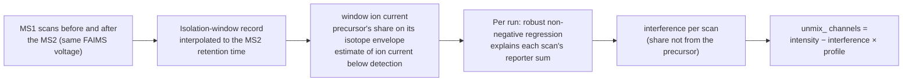

# TMT interference unmixing

## The problem

The reporter ions of a high-resolution MS2 scan come from **everything the quadrupole isolated**,
not just the identified peptide. Precursor purity from MS1 misses much of this, because a lot of
co-isolated ion current is below the MS1 detection limit. The result is ratio compression.

## How it works



No ground truth or reference channel is used; the coefficients come from the run itself. Original
channel columns are unchanged, and the unmixed values are added alongside.

## Measured on a knockout

Yeast triple-knockout TMTpro 16-plex (PXD017803). Interference is the median ratio of knockout to
non-knockout channel intensity for PSMs of the three knocked-out proteins; the true value is zero.


- andes's quantification gate (purity ≥ 0.7 and PEP ≤ 0.05) roughly halves the interference on
  SPS-MS3 (0.128 → 0.064).
- A stricter purity filter gives lower values but keeps fewer PSMs.
- On hrMS2, `--tmt-unmix` sets the median knockout ratio to **0.000**, at a background CV of
  0.124 (0.080 without), so unmixing trades some precision for accuracy.
- Only 36–91 knockout PSMs stand behind each value; read the bars as a direction.

Unmixing applies to high-resolution MS2 reporters only. SPS-MS3 reporters are not modelled.

```bash
andes --spectrum tmt.mzML --database proteins.fasta --tmt --tmt-unmix --rescore
```
