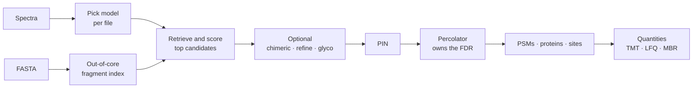

---
hide:
  - navigation
  - toc
---

<div class="andes-hero" markdown>

# andes

**Peptide search and quantification for DDA proteomics.** Give it spectra and a FASTA; it picks the
scoring model from your files, leaves the FDR to Percolator, and can quantify TMT and label-free
data in the same run.

[Install](getting-started/install.md){ .md-button .md-button--primary }
[Benchmarks](benchmarks/index.md){ .md-button }
[Parameters](parameters.md){ .md-button }

</div>

## Try it

=== "Search"

    ```bash
    andes --spectrum spectra.mzML --database proteins.fasta \
          --rescore --output-pin out.pin
    ```

    mzML, MGF, Thermo `.raw` and Bruker `.d` work as they are. The model, tolerances and decoys
    are chosen for you; `--rescore` adds q-values.

=== "TMT"

    ```bash
    andes --spectrum tmt_run.mzML --database human.fasta --mods tmt10_mods.txt \
          --rescore --tmt tmt10 --output-parquet run.idparquet
    ```

    Reporter ions with impurity correction and a precision gate, from the same run as the search.

=== "Label-free + MBR"

    ```bash
    andes --spectrum run1.mzML --spectrum run2.mzML --database human.fasta \
          --rescore --lfq --mbr
    ```

    MS1 quantities, and transfers into runs without an identification, each with its own q-value.

=== "Variants"

    ```bash
    andes --spectrum spectra.mzML --database uniprot_sprot_human.xml.gz \
          --uniprot-variants --rescore --output-pin out.pin
    ```

    Variant claims are checked against [knockoffs](features/knockoffs.md): 65% to 2.5% true FDP
    on a genotyped dataset.

=== "Second peptide"

    ```bash
    andes --spectrum sample.raw --database proteins.fasta --chimeric --rescore
    ```

    A [second peptide per spectrum](features/chimeric.md) from the residual spectrum.

=== "Glyco"

    ```bash
    andes --spectrum sample.mzML --database proteins.fasta --decoy-strategy sequon \
          --glyco --glyco-species human --output-pin results.pin
    ```

    Intact N-glycopeptides from one MS2 scan; [benchmark](benchmarks/glyco.md).

Install with `cargo install --git https://github.com/bigbio/andes --bin andes`, or take a
[release archive](https://github.com/bigbio/andes/releases) for Linux, macOS or Windows.

## In numbers

<div class="grid cards" markdown>

-   **52,169** PSMs on Astral

    Percolator q ≤ 0.01, 114–117 s on 8 threads, 4.8 GB. Comet 2025.01 on the same machine:
    31,435 PSMs, 217 s, 8.1 GB.

-   **0.89–1.08%** true FDP at a nominal 1%

    Entrapment-estimated on Astral with a peptide-level shuffle. Error rates are measured on every
    benchmark, not assumed. [Error control](benchmarks/index.md#error-control-does-the-nominal-1-hold)

-   **65,012** precursors quantified

    In at least 3 runs of the ProteoBench Q Exactive module, median |ε| 0.163.
    [Quantification](quantification.md)

-   **17** bundled scoring models

    Chosen per file from activation, resolution and isobaric label, trained on public PRIDE data.
    [Models](models.md)

</div>

## How it works



[The detailed diagram](how-it-works.md) shows the index, the retrieval step and every optional pass.

## Speed and memory

Same machine, same rescoring, 8 threads. Phospho is the one set where andes uses more memory.


## What is distinctive

<div class="grid cards" markdown>

-   **Knockoff variant FDR**

    A null for variant claims that makes the same mistakes as the claim.
    [Read more](features/knockoffs.md)

-   **Site claims and identity**

    Occupancy and which modification, from competing explanations of each spectrum.
    [Read more](features/sites.md)

-   **Error-controlled match between runs**

    Every transferred quantity says what supports it.
    [Read more](features/mbr.md)

-   **TMT interference unmixing**

    Per-scan co-isolation estimated from MS1, with no reference channel.
    [Read more](features/tmt-unmix.md)

</div>

[All distinctive features](features/index.md){ .md-button }
[Glyco benchmark](benchmarks/glyco.md){ .md-button }
[The quantms ecosystem](ecosystem.md){ .md-button }
