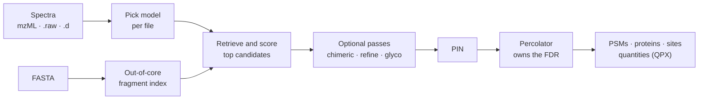

---
hide:
  - navigation
  - toc
---

<div class="andes-hero" markdown>

{ .andes-logo }

**The data-driven peptide search engine and quantification engine of the quantms ecosystem.**
Spectra and a FASTA go in; Percolator-ready PSMs and, on request, protein groups and
label-free or TMT quantities come out. The scoring model is chosen per file from its metadata.

[Get started](getting-started/install.md){ .md-button .md-button--primary }
[Benchmarks](benchmarks/index.md){ .md-button }
[Parameters](parameters.md){ .md-button }

</div>

## What it does

<div class="grid cards" markdown>

-   **Reads your files as they are**

    mzML, MGF, native Thermo `.raw` and Bruker timsTOF `.d`. One of 17 bundled scoring models
    is picked from the file's activation, resolution and isobaric label.
    [How it works](how-it-works.md)

-   **Leaves the FDR to Percolator**

    andes computes no production FDR. It writes the PIN, and Percolator, run by you or by
    `--rescore`, decides what passes `q ≤ 0.01`.
    [Quick start](getting-started/quickstart.md)

-   **Optional modes**

    Co-isolated peptides (`--chimeric`), secondary modifications (`--refine`), and intact
    N-glycopeptides (`--glyco`).
    [Modes](modes.md)

-   **Quantification built in**

    TMT/iTRAQ reporter ions (`--tmt`) and label-free MS1 features with match between runs
    (`--lfq`), from the same run as the search.
    [Quantification](quantification.md)

</div>

## The pipeline at a glance



## Features built around trust in a result

<div class="grid cards" markdown>

-   **Knockoff variant FDR**

    Variant claims get a null that makes the same mistakes as the claim: 65% to 2.5% true FDP on
    a genotyped dataset. [Read more](features/knockoffs.md)

-   **Chimeric cascade**

    A second peptide from the residual spectrum: 43k to 66k Astral PSMs at an equal true FDP of
    1%. [Read more](features/chimeric.md)

-   **Error-controlled match between runs**

    Every transferred quantity says what supports it and carries its own q-value.
    [Read more](features/mbr.md)

-   **TMT interference unmixing**

    Per-scan co-isolation estimated from MS1, with no reference channel.
    [Read more](features/tmt-unmix.md)

</div>

[All distinctive features](features/index.md){ .md-button }
[The quantms ecosystem](ecosystem.md){ .md-button }

## Identifications, measured the same way

PSMs at Percolator `q ≤ 0.01` on public reference datasets, rescored identically for every
engine on the same 8-core machine. The conditions, dates and commits behind each bar are on the
[benchmarks page](benchmarks/index.md).


## CPU time and memory

Same machine, same rescoring, 8 threads. Wall time, CPU time and peak memory for andes and Comet
on four datasets; phospho is the one set where andes uses more memory.


Details and conditions: [benchmarks](benchmarks/index.md#time-cpu-and-memory).

## Search and quantification

andes quantifies as it searches. Label-free runs get MS1 features and match between runs where every
transferred value carries its evidence type and its own q-value; TMT runs get impurity-corrected
reporter ions with a precision gate.


On the Astral module another tool has the lower median error; the
[quantification page](quantification.md) shows both modules with their conditions.

## Glycoproteomics

Intact N-glycopeptide search (`--glyco`) is benchmarked against five published tools on PXD065680,
with entrapment error estimates for andes.


These are counts, not error rates; andes's entrapment FDP is 1.04–1.50% at a nominal 1%. See the
[glyco benchmark](benchmarks/glyco.md) for the overlap, evidence tiers and every deviation from the
paper's protocol.

## Install

```bash
cargo install --git https://github.com/bigbio/andes --bin andes
```

Release archives for Linux, macOS and Windows are on the
[releases page](https://github.com/bigbio/andes/releases). Details: [Install](getting-started/install.md).
