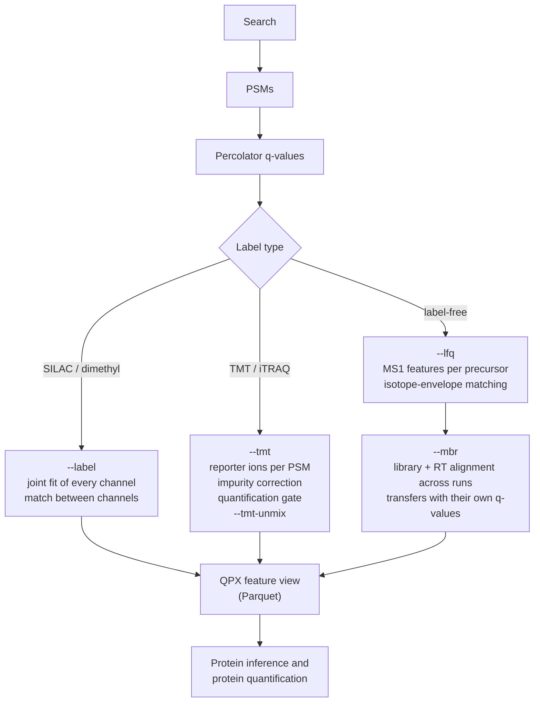

# Quantification

andes is a search engine **and** a quantification engine. Identification and quantification share
one run, one index and one error model, so a quantity always knows which identification supports
it.

| Mode | Flag | What you get |
|---|---|---|
| Reporter ions | `--tmt` | per-PSM reporter intensities (TMT/iTRAQ), isotope-impurity corrected, with a precision gate and a purity-weighted roll-up weight |
| Interference removal | `--tmt-unmix` | per-scan co-isolation estimate and unmixed channels; [details](features/tmt-unmix.md) |
| Label-free | `--lfq` | MS1 feature quantities per precursor and run |
| Labelled pairs | `--label silac2\|silac3\|dimethyl2\|dimethyl3` | every channel of a SILAC or dimethyl peptide from one joint MS1 fit (shared elution, overlapping channels unmixed, deuterium RT offsets learned), unidentified channels matched with their own q-values, log-ratios to a reference channel; with `--mbr`, transfers between runs |
| Match between runs | `--mbr` | quantities in runs without an identification, each with an evidence type and its own q-value; [details](features/mbr.md) |
| Cluster scale | `andes quant library / extract / finalize` | the same MBR split into per-run steps for many runs on a cluster |

## Label-free accuracy on ProteoBench

Median |ε| is the median absolute error of the measured log-ratio against the known mixture
ratio (lower is better); the x axis is the number of precursors quantified in at least 3 runs. Each
point is one leaderboard submission (public snapshot of 2026-07-16); andes is the default
setting at transfer q 0.01 (2026-11-05, `09e1c00d`).

Read the figure with its conditions:

- **Q Exactive module** (PXD028735, 6 runs, human/yeast/*E. coli*): andes quantifies 63,796
  precursors at median |ε| 0.161 and CV 0.117 (52,166 at 0.154 and 0.105 without transfers).
  The listed submissions with the most precursors
  have a higher median error: i2MassChroQ 1.0.16 (74,697, 0.222) and Sage 0.15.0-beta.2 (81,933,
  0.388, transferred values not error-controlled).
- **Astral module** (PXD070049, 6 runs): several submissions have a lower median error than
  andes's 0.186 (36,675 precursors; 31,739 at the same 0.186 without transfers), mostly at fewer
  precursors: DIA-NN 2.6.0 (16,363, 0.123), MaxQuant 2.6.7
  (20,283, 0.160), Sage 0.14.6 (30,319, 0.167) and FragPipe 22.1 (29,105, 0.181). andes's CV (0.112)
  is above most submissions.
- Error control on transferred values differs between submissions; the
  [benchmark report](benchmarks/details.md#2-the-benchmarks) lists what each one checks.
- andes error control: PSM FDP 0.84–0.85% and entrapment-only quantified precursors 0.20–0.21% on
  the Q Exactive set; not measured on Astral.

Cost: 6.2k CPU-seconds for the 6 Q Exactive runs, 5.9k for the 6 Astral runs.

## Match between runs on and off

Eight truth designs (UPS1 in yeast at several levels, human/yeast/*E. coli* mixtures, an absence
design and a blank run) are quantified by andes, MaxQuant 2.7.0.0 and FragPipe (IonQuant, match
between runs on, normalisation off) and read through one evaluation of the raw intensities of every
tool (andes at `09e1c00d`, 2026-11-05). With match between runs on, andes reports 1.1 to 1.6 times
as many cells as without it. Differential expression is scored on the proteins that andes, MaxQuant and
FragPipe all test, with the expected sign required (wrong-sign calls count as false). On that basis andes's
true positives rise from 1,068 to 1,300 (UPS1 in yeast, PXD009740), 1,007 to 1,047 (Q Exactive mixture) and
640 to 685 (Astral mixture); MaxQuant's rise from 1,047 to 1,304, 824 to 857 and 465 to 650 on the same sets.
andes is ahead on the Q Exactive mixture (1,047 against 857 for MaxQuant and 946 for FragPipe) and ties on the
others, with more false calls than MaxQuant on all of them (305 against 129 on PXD009740, 110 against 37 on
the Q Exactive mixture). MaxQuant also has the lower gross errors on the identified cells; andes has the lower
protein CV and more precursors on every set (its search used chimeric spectra, the secondary-modification pass `--refine` and
PSM-level FDR, the other tools a protein-level 1% FDR, so depth is not settings-matched; with matched settings andes' precursors fall 31% on the two UPS1 sets, to the tools' level, and 6-12% on QE and Astral, while its DE true positives do not change). On a design where
yeast is absent from 20 runs, 0.20% of andes's transferred rows are yeast (0.08% at `quant_q ≤ 0.01`) against
0.09% for FragPipe; on yeast-enriched rows only it is 0.052% against 0.010%, and 0.052% against 0.072% when rows
with no reference are counted. The tables, settings and rules are in
the [benchmark report](benchmarks/details.md#2-the-benchmarks).

## TMT

- Reporter extraction and impurity correction match OpenMS IsobaricAnalyzer exactly on the same
  scans.
- Known ratios (PXD007683, human + yeast TMT11, 11 SPS-MS3 fractions): yeast A/C log2 ratio
  **1.589** against the human-normalised expectation 1.688 (nominal 3:1 is 1.585), protein-level
  MAE 0.213; MaxQuant 2.7.0.0 reads 1.700 with MAE 0.159. 9.2 minutes and 17.8 GB on 16 threads.
- Knockout interference (PXD017803): 0.062 on SPS-MS3, 0.027 on RTS-MS3 and 0.192 on hrMS2 against MaxQuant's 0.054, 0.038 and 0.156; details on the
  [unmixing page](features/tmt-unmix.md).
- Match between runs for reporter ions is opt-in (`--tmt --mbr`, hrMS2 only). On PXD014750 it adds
  3,636 transfers at `quant_q ≤ 0.01` (+1.8% rows) whose wrong-value rate is 0.05 points below that
  of the identified values (95% interval −0.56 to +0.51); MaxQuant's isobaric match between runs
  transfers 7,499 cells at +1.53 points and SIMSI-Transfer 16,511 at +0.40.

## At scale

A 500-run study (PXD042233: Q Exactive HF/HF-X and Exploris 480) gives 243,895 precursors in at
least 3 runs and 9,208 protein groups at transfer, precursor and protein q ≤ 0.01, for 146 CPU-hours
end to end. See the [benchmark report](benchmarks/details.md#1-summary) for the conditions, and
[§10 of the reference](reference.md#10-quantification) for every parameter.
