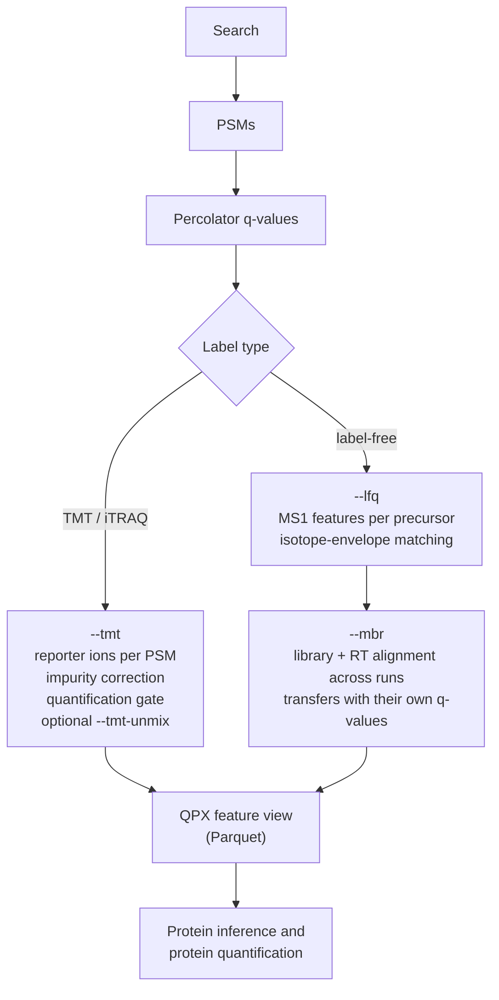

# Quantification

andes is a search engine **and** a quantification engine. Identification and quantification share
one run, one index and one error model, so a quantity always knows which identification supports
it.

| Mode | Flag | What you get |
|---|---|---|
| Reporter ions | `--tmt` | per-PSM reporter intensities (TMT/iTRAQ), isotope-impurity corrected, with a precision gate and a purity-weighted roll-up weight |
| Interference removal | `--tmt-unmix` | per-scan co-isolation estimate and unmixed channels; [details](features/tmt-unmix.md) |
| Label-free | `--lfq` | MS1 feature quantities per precursor and run |
| Match between runs | `--mbr` | quantities in runs without an identification, each with an evidence type and its own q-value; [details](features/mbr.md) |
| Cluster scale | `andes quant library / extract / finalize` | the same MBR split into per-run steps for many runs on a cluster |

## Label-free accuracy on ProteoBench

Median |ε| is the median absolute error of the measured log-ratio against the known mixture
ratio (lower is better); the x axis is the number of precursors quantified in at least 3 runs. Each
point is one leaderboard submission (public snapshot of 2026-07-16); andes is the default
setting at transfer q 0.01 (2026-10-23, `2051616b`).

Read the figure with its conditions:

- **Q Exactive module** (PXD028735, 6 runs, human/yeast/*E. coli*): andes quantifies 65,012
  precursors at median |ε| 0.163 and CV 0.118. The listed submissions with the most precursors
  have a higher median error: i2MassChroQ 1.0.16 (74,697, 0.222) and Sage 0.15.0-beta.2 (81,933,
  0.388, transferred values not error-controlled).
- **Astral module** (PXD070049, 6 runs): several submissions have a lower median error than
  andes's 0.193, mostly at fewer precursors: DIA-NN 2.6.0 (16,363, 0.123), MaxQuant 2.6.7
  (20,283, 0.160), Sage 0.14.6 (30,319, 0.167) and FragPipe 22.1 (29,105, 0.181). andes's CV (0.113)
  is above most submissions.
- Error control on transferred values differs between submissions; the
  [benchmark report](benchmarks/details.md#2-the-benchmarks) lists what each one checks.
- andes error control: PSM FDP 0.83–0.85% and entrapment-only quantified precursors 0.20–0.22% on
  the Q Exactive set; not measured on Astral.

Cost: 6.9k CPU-seconds for the 6 Q Exactive runs, 6.4k for the 6 Astral runs.

## TMT

- Reporter extraction and impurity correction match OpenMS IsobaricAnalyzer exactly on the same
  scans.
- Known ratios (PXD007683, human + yeast TMT11, 11 SPS-MS3 fractions): yeast A/C log2 ratio
  **1.591** against the expected 1.585, protein-level MAE 0.212; 9.6 minutes and 17.5 GB on 16
  threads.
- Interference on a knockout design is on the [unmixing page](features/tmt-unmix.md).

## At scale

A 500-run study (PXD042233: Q Exactive HF/HF-X and Exploris 480) gives 243,895 precursors in at
least 3 runs and 9,208 protein groups at transfer, precursor and protein q ≤ 0.01, for 146 CPU-hours
end to end. See the [benchmark report](benchmarks/details.md#1-summary) for the conditions, and
[§10 of the reference](reference.md#10-quantification) for every parameter.
